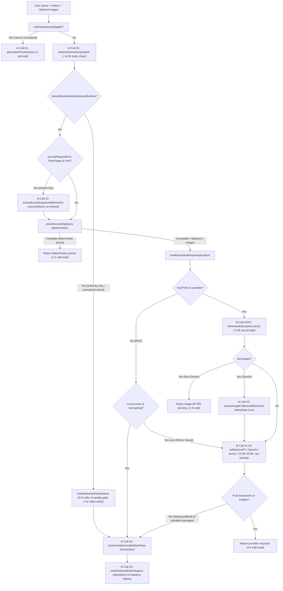

# Accounting App — Code Simplification & AI Token Optimisation Audit

> [!IMPORTANT]
> **Read-Only Audit Baseline**
> - **Repository:** https://github.com/dexrrick/accounting
> - **Baseline Branch & Commit SHA:** `origin/main` @ `348dd7be8220b5224913ec7c1676d4b3d034677a` (`chore: add cloud environment setup configuration (#27)`)
> - **Codebase Footprint (Measured via TypeScript AST scan):** `150` `.ts`/`.tsx` files under `src/`, `73,872` LOC, `5,854` RegExp AST nodes (`RegExpLiteral` + `new RegExp()`).
> - **Verification Integrity:** Zero source or test files modified (`git status` clean); zero live AI provider calls made; offline `npm run lint` passed with `0` errors (`199` warnings, predominantly in `scripts/` and `artifacts/`).

---

## 1. Executive Summary

### Overall Assessment

The accounting application has a **genuinely strong deterministic financial core** ([journalIntegrity.ts](file:///home/antigravity/dexrrick/accounting/src/verification/journalIntegrity.ts), [accountingGuardrails.ts](file:///home/antigravity/dexrrick/accounting/src/engine/accountingGuardrails.ts), [conversationAccountingState.ts](file:///home/antigravity/dexrrick/accounting/src/services/conversationAccountingState.ts), [verifiedGstCalculation.ts](file:///home/antigravity/dexrrick/accounting/src/engine/verifiedGstCalculation.ts), and [sharedDocumentAdmission.ts](file:///home/antigravity/dexrrick/accounting/src/standards/sharedDocumentAdmission.ts)). Its core financial integrity controls — integer-cent balancing, SFRS(I) 1-32 own-equity protection, committed-vs-hypothetical ledger isolation, and official-source provenance gates — are sound and **must be retained**.

However, around that sound core, the application has accumulated **severe orchestration bloat, multi-call AI redundancy, and a recurring regex-patching loop** that directly conflicts with [PROJECT_CHARTER.md](file:///home/antigravity/dexrrick/accounting/docs/PROJECT_CHARTER.md):

1. **Multi-call AI inflation (3–5 sequential calls on ordinary paths):** Despite the Charter's explicit rule that ordinary advisory answers must not require separate AI review/repair calls ([PROJECT_CHARTER.md](file:///home/antigravity/dexrrick/accounting/docs/PROJECT_CHARTER.md#L33)), a mandatory second-stage AI claim-verification call ([`verifySelectedClaimSupport`](file:///home/antigravity/dexrrick/accounting/src/services/evidenceGroundedSynthesis.ts#L1867-L1976)) was re-introduced on `main` (commit `a680323`), firing unconditionally on almost every statutory grounded-synthesis answer. Combined with pre-routing calls (`interpretSemanticQuestion`, unconditional `extractEventSequenceWithGemini`, `AISemanticExtractor.extract`, and `callGeminiAPI` whose `messageText` is subsequently discarded and replaced by `tryGenerateGroundedSynthesis`), normal queries execute **3–5 sequential LLM calls** where **1–2 calls** would suffice.
2. **Regex & rule-pack proliferation (`5,854` RegExp nodes in `73,872` LOC):** Rather than letting AI own natural-language understanding and confining deterministic code to financial math, ledger state, and provenance admission, the codebase runs **5 overlapping classification layers** plus **18 chronological rule-pack files** (`9,006` LOC in `src/retrieval/`). Empirical git churn confirms a persistent fix loop: over the last 100 commits on `origin/main`, [semanticQuestionUnderstanding.ts](file:///home/antigravity/dexrrick/accounting/src/services/semanticQuestionUnderstanding.ts) (`4,626` LOC, `816` regexes) was patched in **41 commits**, [geminiService.ts](file:///home/antigravity/dexrrick/accounting/src/services/geminiService.ts) in **28**, [groundingContextBuilder.ts](file:///home/antigravity/dexrrick/accounting/src/services/groundingContextBuilder.ts) in **26**, [authorityWorkstreams.ts](file:///home/antigravity/dexrrick/accounting/src/services/authorityWorkstreams.ts) in **25**, and [conversationBoundary.ts](file:///home/antigravity/dexrrick/accounting/src/services/conversationBoundary.ts) in **16** (plus **21 additional consecutive boundary-patch commits** on pending branch `codex/phase2-overall-review-4c782e5`).
3. **Avoidable token waste & broken prompt caching:** Every semantic-understanding call transmits **~11,634 static chars (~2,900 est. tokens)** by sending both a `2,568`-char JSON Schema and an `8,235`-char prose schema in the user prompt. Meanwhile, [`formatGroundedSystemPrompt`](file:///home/antigravity/dexrrick/accounting/src/services/groundingContextBuilder.ts#L3283-L3548) interpolates dynamic retrieved evidence between static instructions and the static JSON schema, invalidating automatic prefix caching across Gemini, OpenAI, and Azure OpenAI, while [`azureOpenAiService.ts`](file:///home/antigravity/dexrrick/accounting/src/services/azureOpenAiService.ts#L60-L69) forwards 8 uncondensed conversation turns (including assistant turns on IRAS evidence queries).

### Five Highest-Impact Improvement Opportunities

| Rank | Finding | Opportunity | API Calls Saved (Measured Path Count) | Estimated Token / Latency Impact | Effort |
|---|---|---|---|---|---|
| **1** | **AUD-01** | Gate or retire the mandatory second-stage AI call [`verifySelectedClaimSupport`](file:///home/antigravity/dexrrick/accounting/src/services/evidenceGroundedSynthesis.ts#L1867-L1976) for ordinary grounded statutory answers, restoring Charter alignment (`1` synthesis call instead of `2`) | **−1 sequential LLM call** on nearly every statutory grounded-synthesis query | **~45–50% fewer synthesis prompt tokens** *(aligns with prior measured 48.3–49.2% reduction in [project-architecture-simplification-20261103.txt](file:///home/antigravity/dexrrick/accounting/docs/project-architecture-simplification-20261103.txt#L73-L86))*; **~35–50% lower synthesis latency** *(est.)* | Low–Medium |
| **2** | **AUD-02** | Eliminate wasted pre-routing and discarded LLM calls: gate [`extractEventSequenceWithGemini`](file:///home/antigravity/dexrrick/accounting/src/services/geminiService.ts#L1317-L1335) to multi-event queries (after deterministic checks), stop running `AISemanticExtractor` when `interpretSemanticQuestion` already ran, move image-provider rejection before AI calls, and avoid calling `callGeminiAPI` with verbatim-parroting [`formatIrasEvidencePrompt`](file:///home/antigravity/dexrrick/accounting/src/services/irasEvidencePolicy.ts#L845-L878) when `tryGenerateGroundedSynthesis` will overwrite it | **−1 to −2 sequential LLM calls** on journal, image, non-IRAS statutory, and live-IRAS queries | **~25–50% fewer total request tokens** *(est.)*; **−1 to −2 full provider round-trips** (typically 1.5–6s saved per eliminated call, *est.*) | Medium |
| **3** | **AUD-03 & AUD-04** | Remove schema duplication in [`interpretSemanticQuestion`](file:///home/antigravity/dexrrick/accounting/src/services/semanticQuestionUnderstanding.ts#L885-L982), reorder [`formatGroundedSystemPrompt`](file:///home/antigravity/dexrrick/accounting/src/services/groundingContextBuilder.ts#L3283-L3548) for contiguous static-prefix caching, enforce token caps on main provider prompts, and align [`azureOpenAiService.ts`](file:///home/antigravity/dexrrick/accounting/src/services/azureOpenAiService.ts#L60-L69) history condensation/filtering with Gemini | `0` calls removed; enables provider prefix caching & prevents runaway context | **~1,500–2,000 tokens saved per understanding call** *(est. from cutting redundant `8,235`-char prose schema)*; **~50–75% input-cost discount on cached static prefixes** on Gemini/OpenAI/Azure *(est., provider-dependent)* | Low–Medium |
| **4** | **AUD-06 & AUD-07** | Collapse the 5-layer regex classification & post-LLM override machinery in [semanticQuestionUnderstanding.ts](file:///home/antigravity/dexrrick/accounting/src/services/semanticQuestionUnderstanding.ts) (`4,626` LOC, `816` regexes) and [conversationBoundary.ts](file:///home/antigravity/dexrrick/accounting/src/services/conversationBoundary.ts) (`638` LOC, `92` regexes), trusting validated AI V2 interpretation + canonical topic IDs rather than regex overrides and exact-string routing | `0` extra calls; breaks the primary 41-commit + 21-commit patch loop | **~2,500–3,500 LOC and ~800+ regexes removable** *(est.)*; eliminates cross-layer routing conflicts | High |
| **5** | **AUD-08 & AUD-09** | Consolidate the 6 chronological generations of dated retrieval rule packs (`18` files, `9,006` LOC) into a single data-driven authority rule registry, deduplicate quadruple [`evaluateEvidenceQuality`](file:///home/antigravity/dexrrick/accounting/src/retrieval/evidenceQualityGate.ts) / triple [`verifyEvidenceClaims`](file:///home/antigravity/dexrrick/accounting/src/verification/claimEvidenceVerifier.ts) runs, and unhook the global narrow-pilot `requestCompleteness` grammar | `0` extra calls; cuts local CPU overhead and maintenance sprawl | **~4,000–6,000 LOC reduction** *(est.)*; single authoritative admission/verification pass per issue | High |

---

## 2. Baseline Metrics & Active Pending Branches

### Codebase Subsystem Breakdown (Measured via TypeScript AST)

| Subsystem | Files | Total LOC | RegExp AST Nodes | Last-100-Commit Top Churn File |
|---|---:|---:|---:|---|
| `src/services` | 26 | 25,421 | 1,778 | `semanticQuestionUnderstanding.ts` (41), `geminiService.ts` (28), `groundingContextBuilder.ts` (26), `authorityWorkstreams.ts` (25), `conversationBoundary.ts` (16), `evidenceGroundedSynthesis.ts` (14) |
| `src/retrieval` | 51 | 23,211 | 2,918 | `targetDateResolver.ts` (13), `irasRuleConceptSupport.ts` (9), `irasMasKnowledge20261027b.ts` (9), `acraMomKnowledge20261027b.ts` (9), `cpfPayrollKnowledge20261027b.ts` (8) |
| `src/engine` | 14 | 8,023 | 606 | `scenarioParser.ts` (11) |
| `src/standards` | 17 | 6,174 | 38 | `coverageRegistry.ts` (18) |
| `src/components` | 15 | 3,965 | 14 | `App.tsx` (8) |
| `src/utils` | 12 | 2,542 | 122 | `authorityEvidenceRouting.ts` (10) |
| `src/verification` | 3 | 2,120 | 176 | `claimEvidenceVerifier.ts` (14) |
| `src/classification` | 1 | 763 | 201 | `questionClassifier.ts` (13) |
| `src/types`, `src/worker`, `src/data`, root | 11 | 1,653 | 1 | — |
| **Total (`src/`)** | **150** | **73,872** | **5,854** | — |

### Relevant Pending Remote Branches & Open PRs

To avoid recommending changes already implemented or conflicting with active workstreams, all remote branches ahead of `origin/main` and all open PRs were audited:

| Branch / PR | Divergence vs `main` | Last Updated | Scope & Relevance to This Audit |
|---|---|---|---|
| `codex/review-fx-request-deadline-20261126` | +5 / −1 | 2026-11-27 | **Active Codex branch.** Adds `src/services/requestDeadline.ts`, FX quote-direction & affirmative-evidence guards across `aiTransport.ts`, `geminiService.ts`, `worker/geminiProxy.ts`, `scenarioParser.ts`. **Audit does NOT recommend adding a request-deadline abstraction or FX quote-direction fixes.** |
| `codex/phase2-overall-review-4c782e5` *(subsumes `phase2-invoice-review-7b88385`, `phase2-invoice-and-statutory-03b08a9`, `phase2-share-reset-and-lease-facts-37f9d16`, `phase2-cash-control-2b129dc`, `phase2-journal-recall-fix`)* | +43 / −18 | 2026-11-26 | **Active Codex branch (31 files changed).** Contains 21 consecutive `conversationBoundary.ts` purchase/reset boundary patches + invoice correction & journal-recall fixes across `geminiService.ts`, `evidenceGroundedSynthesis.ts`, `authorityWorkstreams.ts`, `groundingContextBuilder.ts`. **Any Batch 2/3 changes to these files must rebase/coordinate with this branch first.** |
| `codex/live-acceptance-cc36671` / `codex/production-query-routing-p1` | +8 / −1 and +5 / −1 | 2026-11-26 | **Active Codex branches.** Routing P1 fixes for GST registration, journal event extraction failure details, and intercompany loan recovery (`geminiService.ts`, `semanticQuestionUnderstanding.ts`, `evidenceGroundedSynthesis.ts`, `responseAssembler.ts`). |
| `codex/phase3-answer-presentation-20261113` | +2 / −27 | 2026-11-15 | **Pending Codex branch.** Adds true answer presentation & SSE event framing in `aiTransport.ts`, `geminiService.ts`, `aiFirstAdvisory.ts`, `evidenceGroundedSynthesis.ts`. **Audit accounts for this when evaluating Gemini SSE streaming in AUD-05.** |
| `gemini/ai-first-double-entry` | +26 / −136 | 2026-11-18 | **Diverged Gemini branch.** Prototyped single-call AI-first double-entry architecture with deterministic validation and image-revision tracking. Relevant reference for AUD-11 (avoiding greenfield re-invention). |
| **Open PR #26:** `gemini/phase3-payroll-tax-adjustments` | +7 / −136 | 2026-11-04 | Phase 3 payroll/CPF postings, period-end adjustments & tax provisions (`basicTransactions.ts`, `scenarioParser.ts`, `accountingEngine.ts`). |
| **Open Draft PRs #17–#20:** `codex/mas-*` | Historical (Oct 2026) | 2026-10-15 | Older MAS transport/PDF document admission chain; largely superseded on `main`. |

---

## 3. End-to-End AI Request Lifecycle & Measured Call Matrix



### Measured Call Counts & Prompt Sizes by Request Type

> [!NOTE]
> Character counts below are **directly measured** from source constants and offline `localOnly: true` execution on `origin/main` (`348dd7b`). Token equivalents (`chars / 4`) and latency reductions are **estimates**.

| Request Type | Current AI Calls (Measured Path) | Key Prompt Sizes (Measured Static / Offline) | Target Calls After Optimisation |
|---|---|---|---|
| **Simple Conceptual Advisory** (e.g., *"Difference between FVOCI and FVTPL?"*) | **1** (`generateAiFirstAdvisory`) | `ADVISORY_SYSTEM`: `2,912` chars + capped `7,500`-token budget | **1** (already optimal) |
| **Simple Single-Event Journal** (e.g., *"Paid SGD 2,000 rent by bank transfer"*) | **2** on Gemini (`interpretSemanticQuestion` + unconditional `extractEventSequenceWithGemini`), **1** on OpenAI/Azure | `interpretSemanticQuestion`: `11,634` static chars + `extractEventSequence`: `895` chars; if falling through to `callGeminiAPI`, `formatGroundedSystemPrompt` measured **`11,937` chars** (`6` curated summaries!) | **0–1** (skip event-sequence extraction for single-event / deterministic match) |
| **Open-Ended Non-IRAS Transaction** | **3–4** (`interpretSemanticQuestion` + `extractEventSequence` + `AISemanticExtractor` + `callGeminiAPI`) | `11,634` + `895` + `6,266` + `11,937+` chars across 4 calls (**`30,732+` static/prompt chars**) | **1–2** (consolidate extraction; drop redundant `AISemanticExtractor`) |
| **Standard Statutory Advisory** (Authority Workstream / Local IRAS) | **3** (`interpretSemanticQuestion` + `tryGenerateGroundedSynthesis` gen + `verifySelectedClaimSupport`) | `11,634` + (`4,788` sys + packet ≤15k tok) + (`2,837` sys + claims + full same-doc context ≤15k tok) | **2** (`interpretSemanticQuestion` + 1 grounded synthesis call; or **1** when local retrieval can run directly) |
| **Live-Retrieved IRAS or Mixed IRAS + Accounting** | **4** (`interpretSemanticQuestion` + `callGeminiAPI` w/ `formatIrasEvidencePrompt` + synthesis gen + `verifySelectedClaimSupport`) | `11,634` + `13,441+` (`formatIrasEvidencePrompt` measured offline) + synthesis gen + verify | **2** (eliminate verbatim-parroting middle call + second-stage verification call) |
| **Image / Invoice Upload (Gemini)** | **4** (`interpretSemanticQuestion` [text-only] + `AISemanticExtractor` [text-only] + `extractImageEvidenceWithGemini` + `callGeminiAPI`) | Text-only calls run before image is even seen; image `inlineData` is sent once (in Call #3) and **not** re-sent on follow-up turns | **2** (or **1** multimodal extraction+reasoning call; skip text-only pre-calls on image-only prompts) |
| **Image Upload (Azure / OpenAI)** | **1–2 wasted calls**, then error | Runs `interpretSemanticQuestion` + `AISemanticExtractor` before rejecting at `geminiService.ts:1526` | **0** (reject immediately before any AI call) |

---

## 4. Detailed Findings

---

### AUD-01: Mandatory Second-Stage AI Verification Call Re-Introduced in Grounded Synthesis (Charter Conflict)

- **Finding ID:** `AUD-01`
- **Relevant File Paths & Line References:**
  - [evidenceGroundedSynthesis.ts](file:///home/antigravity/dexrrick/accounting/src/services/evidenceGroundedSynthesis.ts#L1832-L1976) (`SUPPORT_VERIFICATION_SYSTEM`, `claimRequiresSemanticVerification`, `verifySelectedClaimSupport`)
  - [evidenceGroundedSynthesis.ts](file:///home/antigravity/dexrrick/accounting/src/services/evidenceGroundedSynthesis.ts#L2092-L2161) (`tryGenerateGroundedSynthesis`)
  - [PROJECT_CHARTER.md](file:///home/antigravity/dexrrick/accounting/docs/PROJECT_CHARTER.md#L27-L33)
  - [project-architecture-simplification-20261103.txt](file:///home/antigravity/dexrrick/accounting/docs/project-architecture-simplification-20261103.txt#L25-L86)
- **Current Behaviour:**
  After [`tryGenerateGroundedSynthesis`](file:///home/antigravity/dexrrick/accounting/src/services/evidenceGroundedSynthesis.ts#L2092-L2161) executes LLM Call #1 (`generation`, line `2104`) and runs deterministic [`validateBundle`](file:///home/antigravity/dexrrick/accounting/src/services/evidenceGroundedSynthesis.ts#L2106), it filters claims with [`claimRequiresSemanticVerification`](file:///home/antigravity/dexrrick/accounting/src/services/evidenceGroundedSynthesis.ts#L1848-L1865) and invokes a second sequential LLM call [`verifySelectedClaimSupport`](file:///home/antigravity/dexrrick/accounting/src/services/evidenceGroundedSynthesis.ts#L1867-L1976). Although the docstring states *"selectively verify source-based statutory meaning"* (line `2091`), `claimRequiresSemanticVerification` ends with an unconditional `return true;` (line `1864`) for every claim whenever the packet has any statutory scope, unless the claim is either an exact validated journal summary or a character-for-character verbatim copy of `passage.verifiedQuote` (`isExactSourceRule`, lines `1840-1846`).
- **Reason Implementation Is Unnecessarily Complex or Inefficient:**
  1. **Direct Charter conflict:** [PROJECT_CHARTER.md](file:///home/antigravity/dexrrick/accounting/docs/PROJECT_CHARTER.md#L33) explicitly mandates: *"Aim for one primary generation call per question... ordinary questions must not require separate AI review and repair calls."* Commit `a6fa330` (Nov 3) removed the second verification call and measured a **48.3–49.2% prompt-character reduction** across all 5 authorities, but commit `a680323` re-introduced `verifySelectedClaimSupport` in a form that fires on virtually **100%** of ordinary paraphrased statutory answers.
  2. **Massive token duplication:** `verifySelectedClaimSupport` sends `SUPPORT_VERIFICATION_SYSTEM` (`2,837` chars) plus re-serializes every `claimPacket`, every `completeAdmittedPassage` (`verifiedQuote`), every `factContext` entry, and up to `12,000` chars of `fullSameDocumentContext` per cited document (`L1883-L1935`)—all of which were already sent in the generation call seconds earlier.
  3. **Sequential latency penalty:** It sits strictly on the critical path before any answer is rendered to the user.
- **Proposed Simplification:**
  - **Option A (Recommended — Charter-aligned):** Remove `verifySelectedClaimSupport` from the default ordinary-question path and rely on the existing deterministic packet checks (`validateBundle`, issue-ID isolation, numeric/date/provision guards, `retainAtomicListSource`, and `addUncoveredIssueLimitations`), reserving any optional second-pass AI verification strictly for explicitly flagged high-ambiguity exceptions (`passage.needsSemanticSupport === true` only — removing the catch-all `return true;` at line `1864` and non-accounting catch-all at line `1862`).
  - Tighten `GENERATION_SYSTEM` slightly where needed (e.g., exception-condition fidelity) rather than paying for a second model pass on every answer.
- **Expected Benefits:**
  - **Measured basis:** Prior removal in [project-architecture-simplification-20261103.txt](file:///home/antigravity/dexrrick/accounting/docs/project-architecture-simplification-20261103.txt#L73-L86) recorded **2 → 1 synthesis calls** and **48.3%–49.2% prompt-character reduction** across IRAS, CPF, MOM, ACRA, and MAS captures with identical displayed answers and citations.
  - **Estimated live impact:** **−1 sequential LLM call** per ordinary statutory grounded answer, **~45–50% fewer synthesis tokens**, and **~35–50% lower synthesis wall-clock latency**.
- **Accounting and Regression Risks:**
  - **Real risk (documented in Nov 3 report):** Deterministic packet checks catch missing citations, cross-issue borrowing, mismatched numbers/dates/provisions, and truncated lists, but cannot catch a subtle qualitative semantic contradiction (e.g., broadening a named legal exception with *"including"* without changing numbers).
  - **Mitigation:** Restricting `claimRequiresSemanticVerification` strictly to `passage.needsSemanticSupport === true` (e.g., complex named-exception passages) preserves semantic review where risk is highest while eliminating it on ordinary general-rule / straightforward statutory answers. Requires explicit user sign-off on the Charter trade-off.
- **Recommended Verification Tests:**
  - `tests/regression/test_evidence_grounded_synthesis.mjs` (and any claim-support regression tests referencing `DETERMINISTIC_AND_SELECTIVE_AI_SUPPORT_CHECK`), plus a bounded live-model spot-check across 5–10 real statutory exception scenarios before production deployment.
- **Implementation Effort:** **Low–Medium** (small code change in one file, moderate regression test updates & real-model quality verification).
- **Supporting Code Evidence:**
  ```ts
  // src/services/evidenceGroundedSynthesis.ts:1858-1865
  if (!hasStatutoryScope) return false;
  const citedPassages = packet.passages.filter(passage => claim.supportIds.includes(passage.id));
  if (citedPassages.some(passage => passage.needsSemanticSupport)) return true;
  if (isExactSourceRule(claim, packet)) return false;
  if (citedPassages.some(passage => !isAccountingPassage(passage))) return true;
  // A journal citation or model label alone never exempts a statutory assertion.
  return true;
  ```

---

### AUD-02: Redundant Sequential AI Calls Across Pre-Routing, Extraction, Provider, and Synthesis

- **Finding ID:** `AUD-02`
- **Relevant File Paths & Line References:**
  - [geminiService.ts](file:///home/antigravity/dexrrick/accounting/src/services/geminiService.ts#L105-L113) (`extractEventSequenceWithGemini`)
  - [geminiService.ts](file:///home/antigravity/dexrrick/accounting/src/services/geminiService.ts#L514-L581) (post-core `tryGenerateGroundedSynthesis` overwriting `callGeminiAPI` output + duplicate `buildGroundedReasoningContext` at `L522-L548`)
  - [geminiService.ts](file:///home/antigravity/dexrrick/accounting/src/services/geminiService.ts#L1178-L1180) (`interpretSemanticQuestion`)
  - [geminiService.ts](file:///home/antigravity/dexrrick/accounting/src/services/geminiService.ts#L1317-L1335) (unconditional `extractEventSequenceWithGemini` call)
  - [geminiService.ts](file:///home/antigravity/dexrrick/accounting/src/services/geminiService.ts#L1526-L1531) (late non-Gemini image rejection)
  - [groundingContextBuilder.ts](file:///home/antigravity/dexrrick/accounting/src/services/groundingContextBuilder.ts#L3079-L3085) (duplicate `AISemanticExtractor.extract`)
  - [irasEvidencePolicy.ts](file:///home/antigravity/dexrrick/accounting/src/services/irasEvidencePolicy.ts#L845-L878) (`formatIrasEvidencePrompt` verbatim-quote middle call)
- **Current Behaviour:**
  Four compounding call-multiplication bugs exist in the main request pipeline:
  1. **Unconditional event-sequence AI call before deterministic parsing:** At [geminiService.ts](file:///home/antigravity/dexrrick/accounting/src/services/geminiService.ts#L1317-L1335), whenever `journalRequested && !hasImages && !irasEvidenceRequired` and a Gemini API key is configured, the app calls `extractEventSequenceWithGemini` **on every journal query**—even simple single-event bookkeeping like *"We paid SGD 2,000 for office rent"*—**before** `parseAccountingQuery` runs, and **without any `AbortController` timeout** (`L105-L113`).
  2. **Two separate pre-reasoning AI classification/extraction calls:** Every non-AI-first query runs `interpretSemanticQuestion` (`L1178`). Then, when `buildGroundedReasoningContext` runs (`L1486`), if `!irasPolicy`, it runs a **second** LLM extraction call `AISemanticExtractor.extract` (`groundingContextBuilder.ts:3079-3085`, `6,266`-char system prompt)—even on non-IRAS statutory questions (MOM/ACRA/CPF/MAS) and even on image uploads (text-only, without the image!).
  3. **Late non-Gemini image rejection & 4-call Gemini image flow:** Non-Gemini providers reject image uploads only at `geminiService.ts:1526-1531`, **after** already executing `interpretSemanticQuestion` and `AISemanticExtractor.extract`. On Gemini, an image query executes **4 sequential AI calls**: `interpretSemanticQuestion` (text-only) → `AISemanticExtractor.extract` (text-only) → `extractImageEvidenceWithGemini` (vision) → `callGeminiAPI` (text reasoning on extracted summary).
  4. **Discarded middle LLM call on live-IRAS / mixed-IRAS queries:** When a live-fetched IRAS or mixed IRAS+accounting query reaches `callGeminiAPI` (`L1542`), `formatIrasEvidencePrompt` (`irasEvidencePolicy.ts:845-878`) instructs the model **not to paraphrase** and only copy-paste exact source sentences into `taxClaims`. Immediately after `processAccountingQueryCore` returns, `processAccountingQuery` (`L514-L581`) sees `displayFullAnswer` is unset, invokes `tryGenerateGroundedSynthesis` (**2 more LLM calls**), and **overwrites `response.messageText` completely** (`L573`). Furthermore, lines `522-548` re-run `buildGroundedReasoningContext` a second time if an IRAS workstream issue had zero verified claims.
- **Reason Implementation Is Unnecessarily Complex or Inefficient:**
  Each feature (event sequences, transaction understanding, image extraction, IRAS evidence policy, grounded synthesis) was appended as an independent sequential stage in `geminiService.ts` without unifying earlier stages or pruning superseded middle calls.
- **Proposed Simplification:**
  1. **Immediate early image-provider guard:** Move the `hasImages && active !== 'gemini'` check (`L1526-L1531`) to the top of `processAccountingQueryCore` (right after journal recall, before line `1174`) → **0 wasted AI calls**.
  2. **Gate `extractEventSequenceWithGemini` & add timeout:** Only invoke `extractEventSequenceWithGemini` when multi-event indicators exist (e.g., multiple dates/events or `transaction 2` / sequence markers) or **after** deterministic single-event parsing fails to produce a complete journal, and wrap its `fetch` in an `AbortController` timeout (aligning with `codex/review-fx-request-deadline-20261126` once merged).
  3. **Eliminate dual pre-extraction (`AISemanticExtractor`):** Skip `AISemanticExtractor.extract` for pure statutory questions (`!accountingRequested && !journalRequested`) and for image-only uploads; for transactions, either rely on the deterministic `DeterministicSemanticExtractor` + main reasoning call's structured output or fold the 5 transaction-fact fields (`ownershipContext`, `currency`, `paymentStatus`, `reportingEntity`, `counterparty`) into a single extraction call when needed.
  4. **Eliminate verbatim-parroting middle call on IRAS-only live queries:** When `groundedContext.evidenceQuality` is set and `!accountingRequested`, pass admitted passages directly to `tryGenerateGroundedSynthesis` (using local deterministic `selectLocalVerifiedClaims` / `verifyEvidenceClaims`) instead of paying for `callGeminiAPI` (`formatIrasEvidencePrompt`) solely to parrot quotes that `tryGenerateGroundedSynthesis` then overwrites. For Gemini image uploads, evaluate consolidating `interpretSemanticQuestion` + `extractImageEvidenceWithGemini` or skipping text-only `interpretSemanticQuestion` when images carry the primary transaction facts.
- **Expected Benefits:**
  - **Measured call reductions:**
    - Simple deterministic journal (Gemini): **2 → 1 call** (or **0** if deterministic fast-path suffices).
    - Non-Gemini image rejection: **1–2 → 0 calls**.
    - Open-ended non-IRAS transaction: **3–4 → 2 calls**.
    - Gemini image upload: **4 → 2 calls**.
    - Live-retrieved IRAS query: **4 → 2 calls** (1 understanding + 1 synthesis, combined with AUD-01).
  - **Estimated token & latency savings:** **~25–50% total input/output token reduction** and **~2–6 seconds latency reduction** on affected paths *(estimated; depends on live provider TTFB)*.
- **Accounting and Regression Risks:**
  - **Medium risk:** Removing `AISemanticExtractor` on open-ended transaction paraphrases could weaken Guardrail A/B/C/F pre-generation hints (`own_equity`, unspecified currency) if `DeterministicSemanticExtractor` misses novel phrasings (tested by `test_ai_semantic_extraction.mjs`). Keep `AISemanticExtractor` ONLY for open-ended transaction queries where deterministic parsing did not match AND `interpretSemanticQuestion` did not extract transaction facts—never for pure statutory or image-rejected queries.
  - **Multi-event risk:** Ensure `extractEventSequenceWithGemini` still triggers for multi-step narratives (e.g., purchase → depreciation → disposal, or *"Transaction 1 ... Transaction 2 ..."*) tested by event-sequence regressions.
  - **Branch coordination:** `codex/live-acceptance-cc36671`, `codex/phase2-overall-review-4c782e5`, and `codex/review-fx-request-deadline-20261126` all edit `geminiService.ts`.
- **Recommended Verification Tests:**
  - `tests/regression/test_ai_semantic_extraction.mjs`
  - `tests/regression/test_event_sequence_*.mjs`
  - `tests/regression/test_image_invoice_*.mjs`
  - `tests/regression/test_iras_evidence_policy.mjs`
  - `npm run test:smoke` + full `npm test`.
- **Implementation Effort:** **Medium**.
- **Supporting Code Evidence:**
  ```ts
  // src/services/geminiService.ts:1324-1332 (fires unconditionally on every non-IRAS journal request!)
  aiExtractionRequired = Boolean(!irasEvidenceRequired && outputJournalRequested && apiKey?.trim() && apiKey.trim().length > 10 && /\btransaction\s*2\b/i.test(userInput));
  if (!irasEvidenceRequired && apiKey?.trim() && apiKey.trim().length > 10) {
    aiCandidate = await extractEventSequenceWithGemini(userInput, apiKey.trim(), geminiConfig?.model || modelName);
  }
  ```
  ```ts
  // src/services/geminiService.ts:514, 571-575 (overwrites callGeminiAPI's messageText!)
  if (response.displayFullAnswer || response.advisoryFailureStatus || response.providerStatus === 'FAILED' || ...) return response;
  ...
  return { ...response, messageText: synthesis.messageText, displayFullAnswer: true, answerPath: 'AI_GROUNDED_SYNTHESIS', ... };
  ```

---

### AUD-03: Massive Schema & Instruction Duplication in `interpretSemanticQuestion`

- **Finding ID:** `AUD-03`
- **Relevant File Paths & Line References:**
  - [semanticQuestionUnderstanding.ts](file:///home/antigravity/dexrrick/accounting/src/services/semanticQuestionUnderstanding.ts#L111-L166) (`SEMANTIC_QUESTION_V2_RESPONSE_JSON_SCHEMA` — `2,568` chars)
  - [semanticQuestionUnderstanding.ts](file:///home/antigravity/dexrrick/accounting/src/services/semanticQuestionUnderstanding.ts#L885-L915) (`SYSTEM_INSTRUCTION` — `831` chars; `RESPONSE_SCHEMA` — `8,235` chars)
  - [semanticQuestionUnderstanding.ts](file:///home/antigravity/dexrrick/accounting/src/services/semanticQuestionUnderstanding.ts#L977-L989) (prompt construction & `responseJsonSchema` dispatch)
  - [aiTransport.ts](file:///home/antigravity/dexrrick/accounting/src/services/aiTransport.ts#L347-L384) (Azure/OpenAI ignoring `responseJsonSchema`)
  - [aiTransport.ts](file:///home/antigravity/dexrrick/accounting/src/services/aiTransport.ts#L493-L499) & [aiTransport.ts](file:///home/antigravity/dexrrick/accounting/src/services/aiTransport.ts#L533-L875) (342 lines of Gemini `responseFormat.text.schema` diagnostics)
- **Current Behaviour:**
  Every non-AI-first query invokes [`interpretSemanticQuestion`](file:///home/antigravity/dexrrick/accounting/src/services/semanticQuestionUnderstanding.ts#L955-L1040). It sends:
  1. `SYSTEM_INSTRUCTION` (`831` chars) as `systemInstruction`,
  2. `RESPONSE_SCHEMA` (`8,235` chars — dense rules, key lists, enums, and a full JSON example) prepended inside the **user** message (`prompt = "${RESPONSE_SCHEMA}\n\n${priorConversationContext}Interpret this question:\n${query}"`), AND
  3. `SEMANTIC_QUESTION_V2_RESPONSE_JSON_SCHEMA` (`2,568` chars) as `responseJsonSchema` in Gemini's `generationConfig.responseFormat.text.schema`.
  Meanwhile, OpenAI and Azure OpenAI ignore `responseJsonSchema` and fall back to `{ type: 'json_object' }` (`aiTransport.ts:347, 383`).
- **Reason Implementation Is Unnecessarily Complex or Inefficient:**
  - Sends **~11,634 static characters (~2,900 estimated tokens)** of schema/instruction boilerplate on **every single request**—often 50× larger than the user's question itself.
  - Because `RESPONSE_SCHEMA` is placed in the `user` message rather than `systemInstruction`, static system instructions are split across two roles, and Gemini receives the full structural specification **twice** (once as wire JSON Schema, once as verbose English prose listing every exact key, enum, and range).
  - OpenAI and Azure OpenAI support native `response_format: { type: 'json_schema', json_schema: ... }` (Structured Outputs) on `gpt-4o` / `2024-08-01-preview`, yet `aiTransport.ts` ignores `responseJsonSchema` for those providers, forcing the bloated prose prompt to act as a crutch.
- **Proposed Simplification:**
  1. Move the static classification rubric into `systemInstruction` (keeping `user` message strictly for conversation context + the user query) so all providers see a clean, cacheable static system prefix.
  2. Wire `responseJsonSchema` to OpenAI/Azure Structured Outputs (`response_format: { type: 'json_schema', ... }`) when supported, and strip redundant structural descriptions (key names, enum lists, min/max wire limits already enforced by JSON Schema) from `RESPONSE_SCHEMA`, condensing the semantic rubric from `8,235` chars to ~`2,000–2,500` chars (~500–625 est. tokens).
  3. Keep `aiTransport.ts`'s `responseFormat` compatibility guard only if live Gemini endpoints still require `responseFormat.text.schema` vs `responseJsonSchema` (verify before removing the 340-line diagnostic parser).
- **Expected Benefits:**
  - **Estimated token savings:** **~1,500–2,000 input tokens saved per `interpretSemanticQuestion` call** (~55–70% reduction in fixed prompt overhead on every non-AI-first query).
  - **Estimated latency benefit:** Smaller prefill + faster structured decoding on Flash-Lite models; cleaner `systemInstruction` prefix improves automatic prefix caching.
- **Accounting and Regression Risks:**
  - **Medium risk:** Over-condensing classification edge-case instructions (e.g., distinguishing `EMPLOYEE` vs `EMPLOYER` vs `COMPANY`, or `CALCULATE` vs `CHECK_ELIGIBILITY`) could alter live-model V2 classifications.
  - **Mitigation:** Keep semantic boundary rules concise and high-signal; validate with offline schema tests plus a bounded live-model benchmark on the existing multi-authority evaluation set before replacing the prompt.
- **Recommended Verification Tests:**
  - `tests/regression/test_semantic_question_understanding.mjs`
  - `tests/regression/test_ai_transport*.mjs`
  - Bounded live-model replay across representative IRAS/CPF/MOM/ACRA/MAS/hybrid queries (cannot be verified by scripted tests alone).
- **Implementation Effort:** **Low–Medium**.
- **Supporting Code Evidence:**
  ```ts
  // src/services/semanticQuestionUnderstanding.ts:977-982
  const prompt = `${RESPONSE_SCHEMA}\n\n${priorConversationContext}Interpret this question:\n${query}`;
  const structuredOptions = {
    jsonMode: true,
    responseJsonSchema: SEMANTIC_QUESTION_V2_RESPONSE_JSON_SCHEMA, // 2,568 chars sent ALONGSIDE 8,235-char RESPONSE_SCHEMA
  ```

---

### AUD-04: Broken Prefix Caching, Uncapped Grounding Prompts, Redundant Context Injection, and OpenAI/Azure History Asymmetry

- **Finding ID:** `AUD-04`
- **Relevant File Paths & Line References:**
  - [groundingContextBuilder.ts](file:///home/antigravity/dexrrick/accounting/src/services/groundingContextBuilder.ts#L3283-L3548) (`formatGroundedSystemPrompt`)
  - [irasEvidencePolicy.ts](file:///home/antigravity/dexrrick/accounting/src/services/irasEvidencePolicy.ts#L845-L878) (`formatIrasEvidencePrompt`)
  - [azureOpenAiService.ts](file:///home/antigravity/dexrrick/accounting/src/services/azureOpenAiService.ts#L60-L85) (`buildAccountingMessages`)
  - [geminiService.ts](file:///home/antigravity/dexrrick/accounting/src/services/geminiService.ts#L2254-L2292) (Gemini history condensation & `evidenceQuality` assistant stripping)
  - [evidenceGroundedSynthesis.ts](file:///home/antigravity/dexrrick/accounting/src/services/evidenceGroundedSynthesis.ts#L959-L1027) (`makePacketForPrompt` duplicate fields)
- **Current Behaviour:**
  1. **Broken prefix caching:** [`formatGroundedSystemPrompt`](file:///home/antigravity/dexrrick/accounting/src/services/groundingContextBuilder.ts#L3283-L3548) concatenates: Static preamble (`~2,800` chars, `L3292-L3324`) → **Dynamic per-request user facts, semantic facts, missing facts, primary statutes, guidance, curated summaries, rules (`L3326-L3448`)** → Static response JSON schema (`~1,400–2,100` chars, `L3450-L3545`)—all inside `systemInstruction` / `role: 'system'`. Because dynamic text sits in the middle, the static prefix is only ~700 tokens (below OpenAI's 1,024-token and Gemini's implicit caching thresholds), and the entire static schema tail is never cached.
  2. **No global token cap & bloated retrieval on simple queries:** Measured offline (`localOnly: true`), `formatGroundedSystemPrompt` produces **`11,937` chars (~`2,984` est. tokens)** for *"We paid SGD 2,000 for office rent by bank transfer. Prepare the journal entry."*—injecting **6 curated standard summaries** for a routine rent entry! Neither `formatGroundedSystemPrompt` nor `formatIrasEvidencePrompt` enforces a global character/token budget (unlike `aiFirstAdvisory.ts`'s `7,500`-token cap and `evidenceGroundedSynthesis.ts`'s `15,000`-token cap).
  3. **Intra-prompt redundancy:**
     - `formatGroundedSystemPrompt:3406-3409` prints **both** `Summary: ${g.principleSummary}` and full `Guidance Text: ${g.sourceText}` per guidance record.
     - Active facts are duplicated across `[1. USER-PROVIDED FACTS]`, `[1.1 UNDERSTOOD TRANSACTION FACTS]`, and `[CURRENT ACTIVE TRANSACTION CONTEXT]` (`geminiService.ts:2281`).
     - In `evidenceGroundedSynthesis.ts:969, 985-999`, `makePacketForPrompt` sends `issueApplicationStatuses` duplicating fields already in `requestedIssues`, and repeats gap descriptions across `missingFactsAndEvidenceGaps`, `scenarioMissingFields`, and `trustedDeterministicOutputs`.
  4. **OpenAI/Azure history bloat & statutory-contamination gap:** `geminiService.ts:2254-2271` limits history to `4` turns, strips markdown tables/journals, truncates assistant text to `400` chars, and **drops all assistant turns when `context.evidenceQuality` is set**. In contrast, `azureOpenAiService.ts:60-69` forwards `8` full, uncondensed turns (including full markdown journal tables and prior assistant prose even on IRAS evidence queries!).
- **Reason Implementation Is Unnecessarily Complex or Inefficient:**
  Static rules and dynamic retrieval context are interleaved in one giant string builder, while Gemini and OpenAI/Azure evolved divergent history-preparation code instead of sharing one bounded conversation-context builder.
- **Proposed Simplification:**
  1. **Reorder `formatGroundedSystemPrompt` for prefix caching:** Place the entire static instruction set + static output schema contiguously at the top of `systemInstruction` (~`4,200–5,000` chars ≈ `1,050–1,250` tokens, crossing OpenAI/Azure's 1,024-token cache threshold), and move all per-request dynamic sections (`[1. USER-PROVIDED FACTS]` through `[7. APPLICATION RULES]`) either to the end of `systemInstruction` or into the `user` message context block.
  2. **Add explicit context budgets & prune irrelevant curated summaries:** Apply a deterministic token budget (e.g., `8,000–10,000` tokens) to `formatGroundedSystemPrompt` and `formatIrasEvidencePrompt`, omit `principleSummary` when `sourceText` is already injected, and cap curated summaries to `2–3` high-relevance records on straightforward `TRANSACTION` queries.
  3. **Deduplicate `makePacketForPrompt`:** Merge `issueApplicationStatuses` into `requestedIssues` and avoid emitting identical gap strings in 3 separate top-level keys.
  4. **Unify history preparation across Gemini, OpenAI, and Azure:** Extract a single shared helper (4-turn window, table/journal stripping, 400-char assistant cap, and mandatory assistant-turn stripping when `evidenceQuality` is set) used by both `geminiService.ts` and `azureOpenAiService.ts`.
- **Expected Benefits:**
  - **Estimated token savings:** **~20–35% smaller grounded system prompts** on routine transactions and multi-turn OpenAI/Azure sessions; **~10–15% smaller synthesis packets** from deduplicating `makePacketForPrompt`; **50–75% provider cache discount** on the static system prefix across repeated turns *(estimated; provider-dependent)*.
  - **Safety improvement:** Closes a real statutory-contamination gap where OpenAI/Azure currently receives prior assistant prose on IRAS evidence-bound turns.
- **Accounting and Regression Risks:**
  - **Low risk** if verbatim `primaryEvidence` and `eligibleRecords` are never truncated mid-sentence or stripped of qualifications/list headers. Truncation/budgeting must drop lower-ranked curated summaries first, never slice an admitted statutory passage in half.
- **Recommended Verification Tests:**
  - `tests/regression/test_iras_evidence_policy.mjs`
  - `tests/regression/test_evidence_grounded_synthesis.mjs`
  - Add a unit test verifying `azureOpenAiService.ts:buildAccountingMessages` strips assistant turns when `evidenceQuality` is set and respects the condensed history cap, and that `formatGroundedSystemPrompt` preserves an identical static prefix across different queries of the same intent/standard.
- **Implementation Effort:** **Low–Medium**.
- **Supporting Code Evidence:**
  ```ts
  // src/services/azureOpenAiService.ts:60-69 (uncondensed 8 turns, NO evidenceQuality assistant filter!)
  const conversationTurns = (chatHistory || [])
    .filter((m) => m.id !== 'welcome-msg' && m.text && !m.text.startsWith('⚠️ **Processing Error**'))
    .slice(-8);
  for (const m of conversationTurns) {
    messages.push({ role: m.sender === 'user' ? 'user' : 'assistant', content: m.text });
  }
  ```

---

### AUD-05: Blind SSE→REST Duplicate Fallback, Missing Output Token Caps, Stale Thinking-Budget Check, and Missing Token Telemetry

- **Finding ID:** `AUD-05`
- **Relevant File Paths & Line References:**
  - [geminiService.ts](file:///home/antigravity/dexrrick/accounting/src/services/geminiService.ts#L2313-L2321) (`thinkingBudget` check)
  - [geminiService.ts](file:///home/antigravity/dexrrick/accounting/src/services/geminiService.ts#L2340-L2420) (SSE buffering & blind fallback to `:generateContent`)
  - [aiTransport.ts](file:///home/antigravity/dexrrick/accounting/src/services/aiTransport.ts#L472-L531) (`callGeminiDirect` missing `maxOutputTokens` and discarding `usageMetadata`)
  - [Header.tsx](file:///home/antigravity/dexrrick/accounting/src/components/Header.tsx#L721-L723) (active Gemini 3.x model IDs)
- **Current Behaviour:**
  1. **Blind duplicate call on SSE failure:** In [`callGeminiAPI`](file:///home/antigravity/dexrrick/accounting/src/services/geminiService.ts#L2340-L2420), the app POSTs to `:streamGenerateContent?alt=sse`, buffers the entire JSON text locally without streaming anything visible to the UI, and if `!streamRes.ok` throws `Error("Streaming response returned ${streamRes.status}")` (`L2381`)—which is caught at `L2383` and **immediately fires a second identical POST to `:generateContent`** (`L2394-L2400`), even when the first call returned HTTP `400`, `401`, `403`, or `429`!
  2. **Zero `maxOutputTokens` / `max_tokens` limits:** None of `aiTransport.ts`, `geminiService.ts`, or `azureOpenAiService.ts` set an output token cap, leaving runaway JSON generation uncapped.
  3. **Stale Gemini 2.5 `thinkingBudget` check:** `geminiService.ts:2313` only configures `thinkingConfig.thinkingBudget` when `modelName.includes('2.5') || modelName.includes('thinking')`, so the default `gemini-3.5-flash-lite` and UI option `gemini-3.8-flash` never receive a thinking cap.
  4. **Blind token telemetry:** `aiTransport.ts` (`callGeminiDirect`, `L525-L530`, and OpenAI/Azure branches) returns only the raw text string and **discards `usageMetadata` / `usage`**. Consequently, `profiler.setTokenCounts` captures **zero** token metrics from `interpretSemanticQuestion`, `AISemanticExtractor`, `generateAiFirstAdvisory`, `tryGenerateGroundedSynthesis`, and `verifySelectedClaimSupport`.
- **Reason Implementation Is Unnecessarily Complex or Inefficient:**
  - Retrying deterministic `4xx`/`429` HTTP errors by switching from SSE to non-SSE doubles rate-limit pressure and adds latency for zero chance of success.
  - Without `usageMetadata` capture on `aiTransport.ts`, teams cannot empirically measure real-world token savings across the 5 largest LLM consumers.
- **Proposed Simplification:**
  1. Restrict the SSE→REST fallback in `callGeminiAPI` strictly to transport/stream parsing failures (never retry HTTP `400`, `401`, `403`, `404`, `413`, `429`). *(Coordinate with pending branch `codex/phase3-answer-presentation-20261113`, which already modifies SSE framing in `geminiService.ts` and `aiTransport.ts`.)*
  2. Set sensible per-stage `maxOutputTokens` / `max_tokens` ceilings (e.g., `1,536` for `interpretSemanticQuestion` / `AISemanticExtractor`, `2,048` for `extractImageEvidence` / `extractEventSequence`, `4,096` for synthesis and main accounting generation).
  3. Audit Gemini 3.x thinking configuration support (`thinkingConfig` / `thinkingLevel`) against provider docs and apply explicit low/zero thinking budgets to pure JSON extraction/classification calls (`interpretSemanticQuestion`, `AISemanticExtractor`, `extractImageEvidence`).
  4. Capture and expose `usageMetadata` / `usage` (prompt tokens, output tokens, cached tokens, thinking tokens) optionally in `aiTransport.ts` telemetry callbacks so all AI calls are measured uniformly.
- **Expected Benefits:**
  - Eliminates duplicate API calls on `4xx`/`429` errors.
  - Prevents runaway output/thinking token spend on extraction calls (**estimated 20–40% latency & output-token reduction on reasoning-enabled Flash models** if thinking tokens are currently uncapped—*requires live verification*).
  - Enables true before/after token telemetry across 100% of AI calls.
- **Accounting and Regression Risks:**
  - **Low risk**, provided `maxOutputTokens` ceilings are generous enough (`4,096` for synthesis/accounting answers) never to truncate valid multi-authority JSON payloads.
- **Recommended Verification Tests:**
  - Unit tests in `tests/regression/test_ai_transport*.mjs` verifying HTTP `400`/`429` does not trigger a second fetch, `maxOutputTokens` is serialized cleanly, and `usageMetadata` is surfaced without breaking the string return contract.
  - Verify Gemini 3.x `thinkingConfig` wire compatibility before deploying to live models.
- **Implementation Effort:** **Low**.
- **Supporting Code Evidence:**
  ```ts
  // src/services/geminiService.ts:2313-2314
  if (modelName.includes('2.5') || modelName.includes('thinking')) { ... } // misses gemini-3.5-flash-lite & gemini-3.8-flash
  // src/services/geminiService.ts:2380-2395
  } else {
    throw new Error(`Streaming response returned ${streamRes.status}`); // caught below -> immediately retries :generateContent even on 400/429!
  }
  ```

---

### AUD-06: 4,626-Line Post-LLM Regex Override Engine & 5-Layer Overlapping Classification

- **Finding ID:** `AUD-06`
- **Relevant File Paths & Line References:**
  - [semanticQuestionUnderstanding.ts](file:///home/antigravity/dexrrick/accounting/src/services/semanticQuestionUnderstanding.ts#L1-L4626) (`4,626` LOC, `816` RegExp nodes; `41` of last `100` commits on `main`):
    - Closed word-allowlist subject validators (`L386-L496`)
    - Post-LLM semantic overrides (`L1150-L1225`, `L1340-L1366`, `L2110-L2136`)
    - Custom English clause splitter & follow-on attacher (`L1394-L1541`)
    - `canonicalRequestedConcepts` & alias ownership checkers (`L1618-L1999`, `L2280-L2584` — ~`685` LOC)
    - `reconcileLegacyQuestionUnderstanding` (`L2680-L2816` — overrides/discards LLM output when `questionClassifier.ts` disagrees)
    - `refineTaxonomyRuleIntent` (`L2990-L3725` — `736` LOC of single-pattern regex rewrites)
    - `appendRequestedStatutoryIssues` (`L4048-L4433` — `385` LOC cloning/splitting/deleting issues)
  - [questionClassifier.ts](file:///home/antigravity/dexrrick/accounting/src/classification/questionClassifier.ts#L81-L762) (`763` LOC, `201` RegExp nodes; `233` LOC of regex missing-fact checklists at `L506-L738`)
  - [queryTopicResolver.ts](file:///home/antigravity/dexrrick/accounting/src/retrieval/queryTopicResolver.ts#L68-L159) & [queryTopicResolver.ts](file:///home/antigravity/dexrrick/accounting/src/retrieval/queryTopicResolver.ts#L327-L696) (`719` LOC, `110` RegExp nodes)
  - [authorityWorkstreams.ts](file:///home/antigravity/dexrrick/accounting/src/services/authorityWorkstreams.ts#L181-L874) (~`600` LOC of topicless concept-to-issue regex ownership & subject heuristics)
  - [authorityEvidenceRouting.ts](file:///home/antigravity/dexrrick/accounting/src/utils/authorityEvidenceRouting.ts#L82-L195) (routing coupled to exact literal English `issue.subject` strings)
- **Current Behaviour:**
  Five independent modules (`queryTopicResolver.ts`, `questionClassifier.ts`, `semanticQuestionUnderstanding.ts`, `authorityWorkstreams.ts`, and `conversationBoundary.ts`) each re-parse the raw query with regexes to determine domain, authority, intent, missing facts, and topic ownership. Even after calling the LLM (`interpretSemanticQuestion`), `semanticQuestionUnderstanding.ts` immediately runs post-hoc regex normalizers (`L1019-L1021`), cross-checks against `questionClassifier.ts` (falling back to `DETERMINISTIC_FALLBACK` on disagreement at `L2729-L2749`), and maintains over `1,800` lines of single-topic regex rewriters (`refineTaxonomyRuleIntent`, `appendRequestedStatutoryIssues`, `canonicalRequestedConcepts`). Meanwhile, `authorityWorkstreams.ts` uses ~`600` lines of regex heuristics (`L278-L874`) to guess which top-level LLM `concept` belongs to which `issue`, and `authorityEvidenceRouting.ts:147-169` checks hardcoded English subject strings like `'Final salary amount calculation by termination reason'` and `'MOM employer salary deduction authorization, purpose and limits'`.
- **Reason Implementation Is Unnecessarily Complex or Inefficient:**
  - Directly violates [PROJECT_CHARTER.md](file:///home/antigravity/dexrrick/accounting/docs/PROJECT_CHARTER.md#L9): *"Do not duplicate natural-language reasoning with growing regex collections, hardcoded question templates or special-case classifications."*
  - Classic **defensive patch-loop symptom**: narrow topics (ACRA Annual Return deadlines, MOM final salary/payslip, CPF rates/refunds/OW, GST motor cars/meals) are special-cased simultaneously across 3–5 files, creating brittle negative-lookahead patches (e.g., filtering `mom-work-passes-s-pass` because `"AGM ... passed"` matched `"pass"` at `semanticQuestionUnderstanding.ts:4058-4062`; 40+ lines of relative-clause regexes at `L2869-L2940` to stop `"bonus"` in a CPF query from triggering IRAS bonus tax).
- **Proposed Simplification:**
  1. **Make the LLM V2 issue schema self-contained:** Emit `concepts` (and/or canonical `topicIds` selected from a compact registry ID list) **inside each `issue` object** rather than as a flat top-level array. This eliminates the ~`600`-line topicless concept-to-issue regex matcher in `authorityWorkstreams.ts:278-874` and ~`685` lines of alias matching in `semanticQuestionUnderstanding.ts`.
  2. **Demote `questionClassifier.ts` to offline/fallback-only:** When `interpretSemanticQuestion` returns a structurally valid `SEMANTIC_INTERPRETATION`, treat it as the authoritative classification instead of discarding it whenever `questionClassifier.ts`'s regexes disagree (`L2729-L2749`). Keep `questionClassifier.ts` strictly for the offline/no-provider fallback path and lightweight pre-routing gates.
  3. **Replace exact-string routing in `authorityEvidenceRouting.ts`** with structured issue properties (`domain`, `governingAuthorities`, `operation`, `mappedTopicIds`) instead of literal English subject strings (`L147-L195`).
  4. **Retire incremental post-LLM topic rewriters** (`refineTaxonomyRuleIntent` `736` LOC, `appendRequestedStatutoryIssues` `385` LOC) in stages as V2 prompt quality is validated against the regression benchmarks.
- **Expected Benefits:**
  - **Code simplification:** Potential removal of **`2,500–3,500+` LOC** and **`~700–1,000` RegExp nodes** across `semanticQuestionUnderstanding.ts`, `authorityWorkstreams.ts`, `questionClassifier.ts`, and `queryTopicResolver.ts` *(estimated)*.
  - **Architectural resilience:** Breaks the #1 maintenance bottleneck (41% of recent commits touching `semanticQuestionUnderstanding.ts`) and enables handling novel phrasings without adding code.
- **Accounting and Regression Risks:**
  - **High regression risk if done all at once:** Many offline regression tests in `tests/regression/` assert exact `DETERMINISTIC_FALLBACK` outputs (running without a live provider) or specific issue-plan structures.
  - **Mitigation:** Preserve deterministic schema validation (`validateSemanticQuestionInterpretation`, `L731-L874`), label sanitization (`L265-L297`), and fail-closed gap reporting (`UNASSIGNED_QUERY_TOPIC` / `hasUnmappedResidual`). Migrate in bounded phases: first move `concepts` per-issue & remove exact-string routing, then simplify `reconcileLegacyQuestionUnderstanding`, and only retire `TAXONOMY_FALLBACK` rewriters once offline tests are aligned with the simplified fallback contract.
- **Recommended Verification Tests:**
  - `tests/regression/test_semantic_question_understanding.mjs`
  - `tests/regression/test_authority_workstreams*.mjs`
  - `tests/regression/test_statutory_answerability_20261027.mjs`
  - Full `npm test` + bounded live-model multi-authority acceptance replay.
- **Implementation Effort:** **High** (structural refactor touching core routing contracts and extensive test suites).
- **Supporting Code Evidence:**
  ```ts
  // src/utils/authorityEvidenceRouting.ts:147-169 (coupled to literal subject strings!)
  const hasFinalSalary = issues.some(issue => issue.subject === 'Final salary amount calculation by termination reason');
  // src/services/semanticQuestionUnderstanding.ts:4058-4062 (brittle keyword collision patch)
  // filters out mom-work-passes-s-pass because "AGM ... passed" matched "pass"
  ```

---

### AUD-07: Regex-Based English Syntax/Discourse Parser in `conversationBoundary.ts` (Recurring Patch Loop)

- **Finding ID:** `AUD-07`
- **Relevant File Paths & Line References:**
  - [conversationBoundary.ts](file:///home/antigravity/dexrrick/accounting/src/services/conversationBoundary.ts#L13-L249) (concatenated NP/modifier regex templates, `SUBJECT_DOMAIN_PATTERNS`, `isActionVerbNegated`, `hasAffirmativeResetDirective`)
  - [conversationBoundary.ts](file:///home/antigravity/dexrrick/accounting/src/services/conversationBoundary.ts#L358-L514) (`maskIndirectQuestionIf`, `isHypotheticalAction`, `extractActionClauseParts`, `resolveActionDomains`, `analyzeTransactionActions`)
  - [semanticQuestionUnderstanding.ts](file:///home/antigravity/dexrrick/accounting/src/services/semanticQuestionUnderstanding.ts#L2604-L2626) (duplicated `isShortSemanticFollowUp`)
  - [journalRequestIntent.ts](file:///home/antigravity/dexrrick/accounting/src/utils/journalRequestIntent.ts#L1-L57) (7 stacked negation regexes, plus duplicate inline negation regexes in `semanticQuestionUnderstanding.ts:1312, 1426, 1913, 2633` and `authorityWorkstreams.ts:1433`)
- **Current Behaviour:**
  `conversationBoundary.ts` (`638` LOC, `92` RegExp nodes) implements a full deterministic English syntactic/discourse parser in regex—including rewriting indirect `"asked ... if"` into `"whether"` (`maskIndirectQuestionIf`, `L358-L363`), parsing VP negation, hypothetical modals, prior-modifier NPs, and coordinated reset directives—to decide `FOLLOW_UP | NEW | AMBIGUOUS` before any AI call runs.
- **Reason Implementation Is Unnecessarily Complex or Inefficient:**
  Git history proves this is an **unending patch loop**:
  - **16 of the last 100 commits** on `origin/main` patched `conversationBoundary.ts` (e.g., `c84fa9e`, `2955f15`, `ce283ca`, `9f9aa31`, `da2ec16`, `c6e9bb3`, `d7f7a23`, `3be6b99`, `9ad861c`).
  - Pending branch `codex/phase2-overall-review-4c782e5` adds **21 more consecutive commits** (`230fcbb` → `c7803d4`) patching edge cases like `"reported temporal and existential purchase boundaries"`, `"quoted purchase conversation boundaries"`, and `"embedded conditional purchase follow-ups"`!
  - Similarly, the last 8 commits on `main` (`9ad861c` → `88fb045`) formed an 8-commit payroll-regex loop that only stabilized when commit `88fb045` finally delegated ambiguous mixed salary/fee clauses to AI reasoning.
- **Proposed Simplification:**
  1. **Keep the small, deterministic safety core** (~`120–150` LOC):
     - `buildAnalysisConversationHistory` & `buildRetryConversationHistory` (`L315-L331`, fail-closed slicing by `analysisStartMessageId`),
     - `isJournalDisplayRequest` (`L9-L11`),
     - Explicit, unambiguous reset phrases (e.g., *"new question"*, *"start over"*, *"forget the previous"*),
     - Conservative `AMBIGUOUS` UI confirmation prompt whenever a committed journal scenario exists and the user submits a substantial unrelated-looking new scenario (letting the user click *"Continue current scenario"* vs *"Start new analysis"* rather than guessing via 400 lines of English grammar regexes).
  2. **Delegate nuanced discourse/anaphora/hypotheticals to AI:** When a query is NOT an explicit reset or journal recall, pass bounded history + active scenario summary to the AI call (already done in `interpretSemanticQuestion` and `generateAiFirstAdvisory`), and add a boolean `startsNewScenario` / `relationToPriorContext` field to the existing V2 interpretation schema (0 extra AI calls!).
  3. **Deduplicate negation helpers:** Consolidate the 4 inline negated-directive regexes in `semanticQuestionUnderstanding.ts` and `authorityWorkstreams.ts` onto `journalRequestIntent.ts`.
- **Expected Benefits:**
  - Eliminates the second-largest patch loop in the repository (`37` combined recent commits across `main` and `codex/phase2-overall-review-4c782e5`).
  - Reduces `conversationBoundary.ts` by **~400–450 LOC** *(est.)* and removes duplicated follow-up logic in `semanticQuestionUnderstanding.ts:2604-2626`.
- **Accounting and Regression Risks:**
  - **High accounting-state risk if weakened carelessly:** Silent cross-contamination between two unrelated transactions (e.g., inheriting an old SGD 100,000 asset purchase into a new rent payment) corrupts journals.
  - **Mitigation:** Preserve the conservative `AMBIGUOUS` user-confirmation fallback when a committed scenario is active, and **wait/coordinate with `codex/phase2-overall-review-4c782e5`** before refactoring `conversationBoundary.ts` so ongoing Codex work is not disrupted.
- **Recommended Verification Tests:**
  - `tests/regression/test_conversation_boundary*.mjs`
  - Multi-turn scenario-isolation and journal-recall tests.
- **Implementation Effort:** **Medium–High** (coordinate with pending Codex branch first).
- **Supporting Code Evidence:**
  ```ts
  // src/services/conversationBoundary.ts:358-363 (regex English grammar rewriting)
  function maskIndirectQuestionIf(text: string): string {
    return text.replace(
      /\b(?:asked|asking|wonder(?:ed|ing)?|check(?:ed|ing)?|know|confirm(?:ed|ing)?|see(?:ing)?)\b([^.?!;]{0,60}?)\bif\b/gi,
      '$1 whether'
    );
  }
  ```

---

### AUD-08: Six Chronological Generations of Date-Stamped Regex Rule Packs in `src/retrieval/` (`9,006` LOC)

- **Finding ID:** `AUD-08`
- **Relevant File Paths & Line References:**
  - `18` knowledge/rule/workflow files in `src/retrieval/` totaling **`9,006` LOC** and **~`2,100+` RegExp nodes**:
    - Gen 1 (Coverage): [irasCpfCoverageRules.ts](file:///home/antigravity/dexrrick/accounting/src/retrieval/irasCpfCoverageRules.ts) (`416` LOC, `139` regexes), [momAcraMasCoverageRules.ts](file:///home/antigravity/dexrrick/accounting/src/retrieval/momAcraMasCoverageRules.ts) (`479` LOC, `166` regexes)
    - Gen 2 (Expansion): [irasCpfExpansionRules.ts](file:///home/antigravity/dexrrick/accounting/src/retrieval/irasCpfExpansionRules.ts) (`497` LOC, `145` regexes), [momAcraMasExpansionRules.ts](file:///home/antigravity/dexrrick/accounting/src/retrieval/momAcraMasExpansionRules.ts) (`510` LOC, `171` regexes)
    - Gen 3 (Practical): [irasAcraPracticalRules.ts](file:///home/antigravity/dexrrick/accounting/src/retrieval/irasAcraPracticalRules.ts) (`250` LOC), [cpfMasPracticalRules.ts](file:///home/antigravity/dexrrick/accounting/src/retrieval/cpfMasPracticalRules.ts) (`231` LOC)
    - Gen 4 (`20261027`): [acraMomPracticalRules20261027.ts](file:///home/antigravity/dexrrick/accounting/src/retrieval/acraMomPracticalRules20261027.ts) (`291` LOC), [irasCpfMasPracticalRules20261027.ts](file:///home/antigravity/dexrrick/accounting/src/retrieval/irasCpfMasPracticalRules20261027.ts) (`534` LOC, `178` regexes)
    - Gen 5 (`20261027b`): [acraMomKnowledge20261027b.ts](file:///home/antigravity/dexrrick/accounting/src/retrieval/acraMomKnowledge20261027b.ts) (`930` LOC, `230` regexes), [cpfPayrollKnowledge20261027b.ts](file:///home/antigravity/dexrrick/accounting/src/retrieval/cpfPayrollKnowledge20261027b.ts) (`1,352` LOC, `221` regexes), [irasMasKnowledge20261027b.ts](file:///home/antigravity/dexrrick/accounting/src/retrieval/irasMasKnowledge20261027b.ts) (`649` LOC, `144` regexes), [statutoryKnowledge20261027b.ts](file:///home/antigravity/dexrrick/accounting/src/retrieval/statutoryKnowledge20261027b.ts) (`94` LOC)
    - Gen 6 (`20261029`): [statutoryWorkflows20261029.ts](file:///home/antigravity/dexrrick/accounting/src/retrieval/statutoryWorkflows20261029.ts) (`871` LOC, `183` regexes)
    - Plus hubs & single-topic support: [practicalStatutoryExpansion.ts](file:///home/antigravity/dexrrick/accounting/src/retrieval/practicalStatutoryExpansion.ts) (`96` LOC), [irasRuleConceptSupport.ts](file:///home/antigravity/dexrrick/accounting/src/retrieval/irasRuleConceptSupport.ts) (`755` LOC, `139` regexes), [statutoryAdvisorySupport.ts](file:///home/antigravity/dexrrick/accounting/src/retrieval/statutoryAdvisorySupport.ts) (`408` LOC, `85` regexes), [momSalaryPaymentRule.ts](file:///home/antigravity/dexrrick/accounting/src/retrieval/momSalaryPaymentRule.ts) (`297` LOC), [acraAnnualReturnFilingRule.ts](file:///home/antigravity/dexrrick/accounting/src/retrieval/acraAnnualReturnFilingRule.ts) (`242` LOC), [masCmsRuleSupport.ts](file:///home/antigravity/dexrrick/accounting/src/retrieval/masCmsRuleSupport.ts) (`200` LOC).
- **Current Behaviour:**
  All 18 files are actively imported at runtime to validate live-fetched HTML/PDF pages (`LIVE_EXTERNAL` candidates) and extract verbatim quotes across `groundingContextBuilder.ts:tryFetch`, `authorityWorkstreams.ts`, `claimEvidenceVerifier.ts`, and `authorityEvidenceResponse.ts`. They are completely disjoint from `src/standards/statutes/*` (`acra.ts`, `cpf.ts`, `gst.ts`, `iras.ts`, `mas.ts`, `mom.ts`) and `coverageRegistry.ts`.
- **Reason Implementation Is Unnecessarily Complex or Inefficient:**
  - **Chronological accretion without consolidation:** Every topic expansion in October 2026 added a new date-stamped file chained via nullish-coalescing fallbacks ([practicalStatutoryExpansion.ts](file:///home/antigravity/dexrrick/accounting/src/retrieval/practicalStatutoryExpansion.ts#L19-L39)).
  - **3×–6× topic overlap:** The exact same statutory domains appear across multiple batches—e.g., ACRA AGM/AR in `statutes/acra.ts`, `acraAnnualReturnFilingRule.ts`, `acraMomPracticalRules20261027.ts`, and `acraMomKnowledge20261027b.ts`; IRAS ECI in `statutes/iras.ts`, `irasAcraPracticalRules.ts`, `irasCpfExpansionRules.ts`, and `irasMasKnowledge20261027b.ts`; CPF wages/rates across **6** separate files; MAS LFMC/VCFM across **6** separate files.
  - Every file re-implements its own text normalization, sentence splitting, date-boundary check, URL matcher, and quote selector.
- **Proposed Simplification:**
  1. Extract one shared, generic rule-evaluation & quote-extraction engine (`src/retrieval/statutoryRuleEngine.ts`) accepting declarative rule descriptors (`id`, `authority`, `topicIds`, `officialUrls`, `effectiveFrom`, `requiredTerms`, `contradictionTerms`, `quoteAnchors`).
  2. Consolidate the 18 date-stamped / batch-named files into **5 authority-organized declarative descriptor modules** (`iras`, `cpf`, `mom`, `acra`, `mas`)—merging overlapping rules for the same topic/URL and reusing URL/effective-date metadata from `src/standards/statutes/*` and `coverageRegistry.ts`.
  3. Keep only genuine domain calculators (e.g., CPF OW/AW ceiling math, ACRA FYE date calculation) as small pure functions rather than tangled inside 1,350-line regex files.
- **Expected Benefits:**
  - **Code simplification:** Estimated **40–60% LOC reduction (`~3,500–5,500` LOC removed)** and elimination of cross-batch precedence bugs (like the legacy-rule URL collision noted at `practicalStatutoryExpansion.ts:88-90`).
  - **Statutory governance:** One single authoritative place per Singapore authority to update when statutory rates/deadlines change (e.g., 2027 MAS misconduct reporting or future CPF ceiling updates).
- **Accounting and Regression Risks:**
  - **High statutory-coverage risk if merged hastily:** Each batch contains subtle date-proof (`sourceProvesKnowledgeDate`) and contradiction rules tied to specific official page phrasing.
  - **Mitigation:** Consolidate one authority at a time (e.g., MAS → ACRA → MOM → CPF → IRAS), preserving 100% of existing official URLs, effective dates, and regression assertions.
- **Recommended Verification Tests:**
  - All `tests/regression/test_*practical*.mjs`, `test_*expansion*.mjs`, `test_*knowledge*.mjs`, `test_statutory_answerability_20261027.mjs`, and `test_cpf_*` / `test_acra_*` / `test_mom_*` / `test_mas_*` / `test_iras_*` suites.
- **Implementation Effort:** **High** (mechanical but large; best done authority-by-authority).
- **Supporting Code Evidence:**
  ```ts
  // src/retrieval/practicalStatutoryExpansion.ts:19-25 (6-layer chronological fallback chain)
  export function supportPracticalExpansionRule(request: PracticalExpansionRequest): boolean | undefined {
    const knowledge = supportStatutoryKnowledgeRule(request);
    if (knowledge === true) return true;
    if (hasStatutoryKnowledgeContradiction(request)) return false;
    return supportIrasCpfExpansionRule(request) ?? supportMomAcraMasExpansionRule(request)
      ?? supportAcraMomPracticalRule(request) ?? supportIrasCpfMasPracticalRule(request) ?? knowledge;
  }
  ```

---

### AUD-09: Redundant Multi-Pass Evidence Validation & Global Narrow-Pilot `requestCompleteness` Overhead

- **Finding ID:** `AUD-09`
- **Relevant File Paths & Line References:**
  - [evidenceQualityGate.ts](file:///home/antigravity/dexrrick/accounting/src/retrieval/evidenceQualityGate.ts) — called **4×** on IRAS workstream queries: [advancedSourceRetriever.ts](file:///home/antigravity/dexrrick/accounting/src/retrieval/advancedSourceRetriever.ts#L298), [groundingContextBuilder.ts](file:///home/antigravity/dexrrick/accounting/src/services/groundingContextBuilder.ts#L3142) & [`L3186`](file:///home/antigravity/dexrrick/accounting/src/services/groundingContextBuilder.ts#L3186) & [`L2461`](file:///home/antigravity/dexrrick/accounting/src/services/groundingContextBuilder.ts#L2461), and [authorityWorkstreams.ts](file:///home/antigravity/dexrrick/accounting/src/services/authorityWorkstreams.ts#L2666)
  - [claimEvidenceVerifier.ts](file:///home/antigravity/dexrrick/accounting/src/verification/claimEvidenceVerifier.ts#L1117) — called **3×**: [irasEvidencePolicy.ts](file:///home/antigravity/dexrrick/accounting/src/services/irasEvidencePolicy.ts#L985), [authorityWorkstreams.ts](file:///home/antigravity/dexrrick/accounting/src/services/authorityWorkstreams.ts#L2780), and [evidenceGroundedSynthesis.ts](file:///home/antigravity/dexrrick/accounting/src/services/evidenceGroundedSynthesis.ts#L374)
  - [rawRequestInventory.ts](file:///home/antigravity/dexrrick/accounting/src/services/rawRequestInventory.ts#L100-L373) (`501` LOC), [requestCompleteness.ts](file:///home/antigravity/dexrrick/accounting/src/services/requestCompleteness.ts#L1-L549) (`549` LOC), [requestedTopicOwnership.ts](file:///home/antigravity/dexrrick/accounting/src/services/requestedTopicOwnership.ts#L42-L350) (`350` LOC) — **`1,400` LOC** wired globally into `geminiService.ts`, `aiFirstAdvisory.ts`, `groundingContextBuilder.ts`, `authorityWorkstreams.ts`, `irasEvidencePolicy.ts`, `semanticQuestionUnderstanding.ts`, and `evidenceGroundedSynthesis.ts`
  - [authorityEvidenceResponse.ts](file:///home/antigravity/dexrrick/accounting/src/services/authorityEvidenceResponse.ts#L44-L143) & [geminiService.ts](file:///home/antigravity/dexrrick/accounting/src/services/geminiService.ts#L691) (renders deterministic answer, discards on synthesis success, rebuilds on synthesis failure)
  - [citationVerifier.ts](file:///home/antigravity/dexrrick/accounting/src/verification/citationVerifier.ts#L46) (still defaults to legacy `defaultSourceRetriever` instead of `defaultAdvancedSourceRetriever`)
- **Current Behaviour:**
  1. On an IRAS authority-workstream query, `evaluateEvidenceQuality` runs up to **4 times** and `verifyEvidenceClaims` runs up to **3 times** over the exact same source records and quotes.
  2. `rawRequestInventory.ts` + `requestCompleteness.ts` + `requestedTopicOwnership.ts` (`1,400` LOC) implement a narrow finite-grammar pilot covering only `iras-individual-reliefs` child topics and `cpf_contribution_rates` (including hardcoded literal sentences like `what does the employer have to pay into cpf` at `requestedTopicOwnership.ts:119`), yet `ensureRequestCompletenessContext` is threaded through **7 core service files** and executed on every single query—even pure conceptual AI-first advisories (`aiFirstAdvisory.ts:494`)!
  3. `renderAuthorityEvidenceResponseText` runs unconditionally before `tryGenerateGroundedSynthesis` overwrites it, and then runs *again* in `createGroundedSynthesisFailureResponse` (`geminiService.ts:691`) if synthesis fails.
- **Reason Implementation Is Unnecessarily Complex or Inefficient:**
  Repeated defensive re-validation across pipeline handoffs increases code coupling, slows local execution (especially on multi-issue queries), and makes every service file carry a `requestCompletenessContext` parameter for a single narrow topic family.
- **Proposed Simplification:**
  1. **Single-pass provenance & claim verification:** Pass structured, already-verified `EvidenceQualityAssessment` and `VerifiedEvidenceClaim[]` artifacts downstream (typed as verified) so `authorityWorkstreams.ts` and `evidenceGroundedSynthesis.ts` do not re-run `evaluateEvidenceQuality` / `verifyEvidenceClaims` on identical inputs.
  2. **Scope or retire the `requestCompleteness` pilot:** Restrict `rawRequestInventory` / `requestedTopicOwnership` strictly to the `iras-individual-reliefs` routing-parent scope where it actually applies (lazy-invoked only when `iras-individual-reliefs` is matched), removing `requestCompletenessContext` threading from `aiFirstAdvisory.ts` and unrelated request paths—or replace it with standard per-issue V2 completeness checks.
  3. **Lazy deterministic rendering:** Build `renderAuthorityEvidenceResponseText` only when no AI synthesis will run or inside the synthesis-failure catch path (reusing the built response rather than building twice).
  4. **Align `CitationVerifier` retriever:** Ensure `CitationVerifier` shares the active versioning/source manager with `defaultAdvancedSourceRetriever` rather than a separate `defaultSourceRetriever` instance.
- **Expected Benefits:**
  - Removes **~`1,000–1,400` LOC** of narrow pilot plumbing *(if retired)* or isolates it to 1 topic family.
  - Eliminates 2–3 redundant verification passes per statutory query and cuts cross-module parameter threading across 7 service files.
- **Accounting and Regression Risks:**
  - **Medium risk:** Ensure no unverified or cross-issue record can bypass `verifySharedDocumentAdmission` or `verifyEvidenceClaims` once. Keep a single authoritative admission gate at retrieval exit and a single claim-verification pass at workstream/IRAS exit.
  - **Pilot regression tests:** `tests/regression/test_request_completeness*.mjs` and `test_requested_topic_ownership*.mjs` explicitly test the CPF/relief pilot contract; confirm with the user whether to scope or sunset that pilot.
- **Recommended Verification Tests:**
  - `tests/regression/test_claim_evidence_verifier*.mjs`
  - `tests/regression/test_evidence_quality_gate*.mjs`
  - `tests/regression/test_request_completeness*.mjs`
  - `tests/regression/test_citation_verifier*.mjs`
- **Implementation Effort:** **Medium**.
- **Supporting Code Evidence:**
  ```ts
  // src/services/requestedTopicOwnership.ts:117-120 (hardcoded single-sentence grammar wired globally)
  // The retained compound query asks this separate CPF payroll calculation.
  patterns.push({
    source: String.raw`what\s+does\s+the\s+employer\s+have\s+to\s+pay\s+into\s+cpf`,
    topicId: 'cpf_contribution_rates',
  ```

---

### AUD-10: Statutory Advisory Leakage Inside `src/engine/` & Duplicated Post-Processing

- **Finding ID:** `AUD-10`
- **Relevant File Paths & Line References:**
  - [irasApplicationEvaluator.ts](file:///home/antigravity/dexrrick/accounting/src/engine/irasApplicationEvaluator.ts#L17-L58) (pure IRAS tax evaluator in `src/engine/`)
  - [acraAnnualReturnApplication.ts](file:///home/antigravity/dexrrick/accounting/src/engine/acraAnnualReturnApplication.ts#L1-L310) (pure ACRA filing deadline evaluator in `src/engine/`)
  - [scenarioParser.ts](file:///home/antigravity/dexrrick/accounting/src/engine/scenarioParser.ts#L26-L88) (`isStatutoryInquiry`), [`L179-L226`](file:///home/antigravity/dexrrick/accounting/src/engine/scenarioParser.ts#L179-L226) (GST registration advisory), [`L1486-L1633`](file:///home/antigravity/dexrrick/accounting/src/engine/scenarioParser.ts#L1486-L1633) (`SINGAPORE_STATUTORY_ADVISORY`), and hardcoded `singaporeTaxTreatmentSummary` strings across 9 scenario branches; plus hardcoded benchmark dollar defaults (`L1649-L1755`: `newCost = 100000`, `oldCost = 50000`, `agreedTradeInGross = 21800`; `L2001-L2056`: `listPrice = 20000`, `discountRate = 0.10`; `L2796-L2848`: FX `1.34`/`1.36`)
  - [responseAssembler.ts](file:///home/antigravity/dexrrick/accounting/src/engine/responseAssembler.ts#L98-L265) (IRAS meal input-GST policy in `src/engine/`), [`L650-L710`](file:///home/antigravity/dexrrick/accounting/src/engine/responseAssembler.ts#L650-L710) (hardcoded statutory fallback URLs & Acts)
  - [groundingContextBuilder.ts](file:///home/antigravity/dexrrick/accounting/src/services/groundingContextBuilder.ts#L3557-L3845) (`postProcessAIResponse` duplicating `assembleDeterministicResponse`)
- **Current Behaviour:**
  1. Pure statutory evaluators (`irasApplicationEvaluator.ts`, `acraAnnualReturnApplication.ts`), IRAS meal-GST policy (`responseAssembler.ts:98-265`), and a full statutory query router (`scenarioParser.ts:1486-1633`) live inside `src/engine/`—the double-entry accounting engine—and embed hardcoded tax/regulatory prose and fallback URLs (`responseAssembler.ts:666-699`).
  2. `postProcessAIResponse` (`groundingContextBuilder.ts:3557-3845`) duplicates `assembleDeterministicResponse` (`responseAssembler.ts:272-1141`): both independently normalize `directGroups`, apply trade-discount guardrails, run `CitationVerifier`, guard meal-GST claims, and append uncertainty disclaimers.
  3. `scenarioParser.ts` falls back to **hardcoded benchmark numbers** (`\$100,000` new PPE, `\$50,000` old PPE, `\$20,000` list price, `1.34`/`1.36` FX) when amounts aren't matched by regex!
- **Reason Implementation Is Unnecessarily Complex or Inefficient:**
  - Directly violates [PROJECT_CHARTER.md](file:///home/antigravity/dexrrick/accounting/docs/PROJECT_CHARTER.md#L19-L24) ("Keep statutory advisory validation separate from journal validation... Accounting treatment and statutory/tax treatment remain distinct") and creates circular cross-layer imports (`groundingContextBuilder.ts` importing meal-GST logic from `src/engine/responseAssembler.ts:23`).
  - Hardcoded dollar defaults in `scenarioParser.ts` risk **fabricating unstated transaction amounts** if a user omits a figure in a real query that matches a fixture pattern—violating core accounting correctness rules.
- **Proposed Simplification:**
  1. **Restore strict Charter boundary:** Move `irasApplicationEvaluator.ts`, `acraAnnualReturnApplication.ts`, and the meal-GST guard out of `src/engine/` into `src/services/` (or `src/retrieval/`), and remove `SINGAPORE_STATUTORY_ADVISORY` (`scenarioParser.ts:1486-1633`) once statutory routing is owned exclusively by `authorityWorkstreams.ts` / `aiFirstAdvisory.ts`.
  2. **Unify `postProcessAIResponse` and `assembleDeterministicResponse`:** Consolidate shared `directGroups` normalization, trade-discount guardrails, and citation verification into one shared helper so changes aren't made twice.
  3. **Remove silent benchmark defaults in `scenarioParser.ts`:** Never default missing monetary amounts or FX rates to hardcoded sample numbers (`100000`, `20000`, `1.34/1.36`) outside explicit sample-scenario fixtures; instead emit `isComplete: false` with `missingFields`!
- **Expected Benefits:**
  - Clean separation between deterministic double-entry accounting (`src/engine/`) and Singapore statutory advisory (`src/services/` + `src/retrieval/`).
  - Eliminates a latent accounting-integrity defect (fabricated default amounts/FX rates) and ~`300–500` LOC of duplicated post-processing.
- **Accounting and Regression Risks:**
  - **Medium risk:** Removing hardcoded defaults in `scenarioParser.ts` will break any old fixture test that relies on implicit benchmark amounts without stating them in the prompt; those tests must be checked to ensure sample prompts state their figures explicitly (as real users must).
- **Recommended Verification Tests:**
  - `tests/regression/test_response_assembler*.mjs`
  - `tests/regression/test_ppe_*.mjs`, `test_trade_discount*.mjs`, `test_fx_*.mjs`
  - `tests/regression/test_journal_integrity*.mjs` (confirm `UNSTATED_AMOUNT` protection holds).
- **Implementation Effort:** **Medium**.
- **Supporting Code Evidence:**
  ```ts
  // src/engine/scenarioParser.ts:1649-1655 (silent benchmark defaults in production parser!)
  let newCost = 100000;
  let oldCost = 50000;
  let agreedTradeInGross = 21800;
  ```

---

### AUD-11: Triple Transaction Classification, Redundant Canned Advisory Interceptors, and Hardcoded Offline Renderer

- **Finding ID:** `AUD-11`
- **Relevant File Paths & Line References:**
  - [basicTransactions.ts](file:///home/antigravity/dexrrick/accounting/src/engine/basicTransactions.ts#L417-L704) (`1,287` LOC, `171` regexes; 19 templates)
  - [scenarioParser.ts](file:///home/antigravity/dexrrick/accounting/src/engine/scenarioParser.ts#L420-L2980) (`3,023` LOC, `163` regexes; plus follow-up settlement/projection duplication at `L2529-L2687` vs `responseAssembler.ts:381-495`)
  - [transactionUnderstandingService.ts](file:///home/antigravity/dexrrick/accounting/src/services/transactionUnderstandingService.ts#L527-L1237) (`DeterministicSemanticExtractor`, `710` LOC)
  - [sfrsi9AnswerService.ts](file:///home/antigravity/dexrrick/accounting/src/services/sfrsi9AnswerService.ts#L16-L280) (`280` LOC canned SFRS(I) 9 templates)
  - [consolidationKnowledgeService.ts](file:///home/antigravity/dexrrick/accounting/src/services/consolidationKnowledgeService.ts#L41-L485) (`486` LOC, `125` regexes; canned consolidation templates)
  - [geminiService.ts](file:///home/antigravity/dexrrick/accounting/src/services/geminiService.ts#L1371-L1391) (interceptor call site) & [`L1617-L2223`](file:///home/antigravity/dexrrick/accounting/src/services/geminiService.ts#L1617-L2223) (`renderStructuredOfflineResponse`, `607` LOC with hardcoded fixture prose & numbers)
- **Current Behaviour:**
  1. **Triple deterministic transaction parsing:** `basicTransactions.ts`, `scenarioParser.ts`, and `DeterministicSemanticExtractor` each implement independent regex classifiers and amount/currency extractors for overlapping domains (equipment purchases, general expenses, own equity, leases, loans, receivables/payables). Follow-up settlements and FVOCI/FVTPL projections are handled twice (`scenarioParser.ts:2529-2687` via sync deterministic extractor AND `responseAssembler.ts:381-495` via AI `semanticUnderstanding`).
  2. **Canned regex interceptors bypassing AI-first advisory:** `sfrsi9AnswerService.ts` and `consolidationKnowledgeService.ts` (`766` LOC combined) intercept conceptual accounting queries at `geminiService.ts:1374-1391` with static markdown templates. The comment at `geminiService.ts:1371-1373` explicitly admits this was placed before `parseAccountingQuery` as a workaround so `"carrying amount"` would not trigger `scenarioParser.ts`'s passenger motor car parser!
  3. **Hardcoded numbers in `renderStructuredOfflineResponse` (`geminiService.ts:1617-2223`):** Contains `607` lines of legacy template prose with hardcoded dollar figures (`costVal || 18000`, `gstVal || 1620`, `bankVal || 5000`, `payableVal || 14620` at `L2001-L2004`; literal `SGD 50,000` / `SGD 100,000` / `SGD 21,800` / `SGD 57,200` in `PPE_IAS16` prose at `L2054-L2096`; literal `1.34`/`1.36` at `L2145-L2146`; `SGD 4.36` at `L1929`).
- **Reason Implementation Is Unnecessarily Complex or Inefficient:**
  - Maintenance overhead of 3 competing transaction parsers + fragile ordering workarounds (`carrying amount` → `car`).
  - `renderStructuredOfflineResponse` can render **wrong narrative numbers that contradict the journal table** whenever a user supplies non-default amounts and hits the offline fallback!
- **Proposed Simplification:**
  1. **Immediate safety fix in `renderStructuredOfflineResponse`:** Replace hardcoded literal numbers in narrative templates (`L1929, L2001-L2004, L2054-L2096, L2145-L2146`) with dynamic values read strictly from `scenario.directGroups` / `scenario.keyParameters`, rendering a generic structured summary of computed journal lines rather than scenario-specific essays (cutting ~`350–400` LOC).
  2. **Fix the `"carrying amount"` regex bug at the source** (`scenarioParser.ts:90-99` word boundaries) and evaluate retiring `sfrsi9AnswerService.ts` / `consolidationKnowledgeService.ts` into the unified `aiFirstAdvisory.ts` + `standardsKnowledge.ts` grounded path when a provider is configured (retaining deterministic local lookup only for offline mode).
  3. **Do NOT rewrite `scenarioParser.ts` from scratch right now:** Note that pending branch `gemini/ai-first-double-entry` (`+26 / -136`) already explored consolidating double-entry parsing into an AI-first structured pipeline with deterministic calculation/validation. Evaluate and cherry-pick/rebase proven ideas from that branch in a dedicated later phase rather than launching a parallel rewrite.
- **Expected Benefits:**
  - Eliminates contradictory hardcoded narrative numbers in offline fallbacks (real accounting accuracy fix).
  - Removes ~`400–1,100` LOC across `renderStructuredOfflineResponse`, `sfrsi9AnswerService.ts`, and `consolidationKnowledgeService.ts` *(est.)*.
- **Accounting and Regression Risks:**
  - **Medium risk:** `sfrsi9AnswerService.ts` and `consolidationKnowledgeService.ts` have dedicated offline regression suites (`test_sfrsi9_*`, `test_consolidation_*`) verifying zero-hallucination citations on offline runs; keep them as offline-only fallbacks unless those suites are explicitly transitioned to grounded synthesis.
- **Recommended Verification Tests:**
  - `tests/regression/test_sfrsi9_*.mjs`, `tests/regression/test_consolidation_*.mjs`, `tests/regression/test_basic_transactions*.mjs`, `tests/regression/test_ppe_*.mjs`.
- **Implementation Effort:** **Low** (for `renderStructuredOfflineResponse` cleanup & word-boundary fix) / **High** (for full parser consolidation — defer to dedicated batch aligned with `gemini/ai-first-double-entry`).
- **Supporting Code Evidence:**
  ```ts
  // src/services/geminiService.ts:1371-1373
  // Serve reviewed SFRS(I) 9 knowledge queries before transaction parsing.
  // This also avoids unrelated parser matches (for example, "carrying amount"
  // being interpreted as a passenger motor car) without changing parser rules.
  ```

---

### AUD-12: Dead Modules, Deprecated Functions, Unreachable Code, and 49 Unused Exports

- **Finding ID:** `AUD-12`
- **Relevant File Paths & Line References:**
  - [FinancialImpact.tsx](file:///home/antigravity/dexrrick/accounting/src/components/FinancialImpact.tsx) (`0` references in `src/`, `tests/`, or `scripts/`)
  - [shareTransferEngine.ts](file:///home/antigravity/dexrrick/accounting/src/engine/shareTransferEngine.ts#L48-L119) (`calculateShareTransfers` — `0` callers in `src/`; live queries use `shareTransferQuery.ts` only; referenced in `1` test file `tests/regression/test_share_transfer_engine.mjs`)
  - [eventSequence.ts](file:///home/antigravity/dexrrick/accounting/src/engine/eventSequence.ts#L130-L131) (`@deprecated resolveInventoryEventSequence` — `0` callers in `src/`)
  - [corporateTaxTreatment.ts](file:///home/antigravity/dexrrick/accounting/src/services/corporateTaxTreatment.ts#L17-L44) (`44` LOC; single caller `scenarioParser.ts:2343` ignores returned `sourceRecordIds`)
  - [accountingEngine.ts](file:///home/antigravity/dexrrick/accounting/src/engine/accountingEngine.ts#L288-L474) (`EQUITY_INVESTMENT_FX` calculation branch bypassed for parser-built FX scenarios because `scenarioParser.ts:2856` already populates `directGroups`)
  - **`49` dead exported symbols** across `src/` with zero external references in `src/`, `tests/`, or `scripts/` (verified via TypeScript AST scan), including:
    - `groundingContextBuilder.ts:2887` (`buildGroundingEvidenceTrace`)
    - `semanticQuestionUnderstanding.ts:2087` (`hasSemanticQueryContractContradiction`)
    - `cpfPayrollKnowledge20261027b.ts:1323` (`renderCpfPayrollCalculation`), `L170`, `L1330`, `L1345`
    - `statutoryWorkflows20261029.ts:462, 591`
    - `irasMasKnowledge20261027b.ts:528`
    - `liveRegulatoryFeed.ts:157` (`OFFICIAL_SOURCE_ENDPOINTS`)
    - `aiFirstAdvisory.ts:37, 444` (unnecessary exports; internal-only)
    - `conversationBoundary.ts:23, 66`
    - `geminiService.ts:105, 2225` (exported unnecessarily; internal-only)
    - `transactionUnderstandingService.ts:96, 123, 144, 162, 188, 1239, 1384, 1389` (internal-only)
    - Plus `76` additional exports referenced **only** by `tests/` or `scripts/` (not by any production module).
- **Current Behaviour:**
  Unused components, deprecated functions, and dead exports accumulate across the repository, inflating cognitive load, bundle surface, and refactoring friction (especially when dead exports appear public).
- **Reason Implementation Is Unnecessarily Complex or Inefficient:**
  Dead code misleads contributors and subagents into maintaining obsolete paths (e.g., `FinancialImpact.tsx`, `renderCpfPayrollCalculation`, `resolveInventoryEventSequence`) and obscures the true public API surface of large modules.
- **Proposed Simplification:**
  1. Remove `src/components/FinancialImpact.tsx` (confirmed 0 references anywhere).
  2. Remove `@deprecated resolveInventoryEventSequence` and unused dead helpers (`buildGroundingEvidenceTrace`, `hasSemanticQueryContractContradiction`, `renderCpfPayrollCalculation`, etc.), and un-export internal-only helpers that have zero external callers.
  3. Decide whether `src/engine/shareTransferEngine.ts` should be wired into `shareTransferQuery.ts` (if deterministic multi-transfer ledger calculation is still desired) or archived/removed alongside its standalone test.
  4. Verify whether `accountingEngine.ts:288-474` is still needed for direct UI/parameter-change recalculations (via `App.tsx:249` when a user edits parameters without `directGroups`) before touching it!
- **Expected Benefits:**
  - Cleaner module boundaries, smaller bundle/AST footprint, reduced false-positive surface during maintenance.
- **Accounting and Regression Risks:**
  - **Very low risk** for strictly 0-reference dead code (`FinancialImpact.tsx`, truly unreferenced functions).
  - **Verify before deleting:** Confirm `accountingEngine.ts:288-474` is not hit by interactive parameter sliders/edits in UI or legacy fixtures; confirm `shareTransferEngine.ts` intent with the user.
- **Recommended Verification Tests:**
  - `npm run lint`, `npm run build` (`tsc -b` + Vite + worker build), `npm run test:smoke`.
- **Implementation Effort:** **Low**.
- **Supporting Code Evidence:**
  AST import-graph scan across all `150` `src/` files + `486` test files + `36` script files confirmed `src/components/FinancialImpact.tsx` has `0` importers, `src/engine/shareTransferEngine.ts` has `0` `src/` importers (`1` test ref), and `49` exported symbols have `0` external references anywhere in the repo.

---

## 5. Architectural Alignment Assessment

| Principle (Prompt & [PROJECT_CHARTER.md](file:///home/antigravity/dexrrick/accounting/docs/PROJECT_CHARTER.md)) | Alignment Rating | Evidence-Based Assessment |
|---|---|---|
| **1. AI-first reasoning rather than excessive deterministic classification** | **Misaligned (Poor)** | `5,854` RegExp AST nodes across `src/`; `semanticQuestionUnderstanding.ts` (`4,626` LOC, `816` regexes) overrides validated LLM output with deterministic regexes and falls back whenever `questionClassifier.ts` (`201` regexes) disagrees; `conversationBoundary.ts` implements a regex English grammar parser. |
| **2. Deterministic controls only where necessary for financial accuracy, data integrity & safety** | **Mixed (Core Strong, Perimeter Bloated)** | Financial core (`journalIntegrity.ts`, `accountingGuardrails.ts`, `conversationAccountingState.ts`, `verifiedGstCalculation.ts`, `sharedDocumentAdmission.ts`) is exemplary. Perimeter layers (`requestCompleteness` pilot, 6 generations of dated retrieval regex packs, 4× quality gate / 3× claim verification) go far beyond necessary controls. |
| **3. Single-generation advisory wherever practical** | **Misaligned (Regressed)** | Pure conceptual advisory (`aiFirstAdvisory.ts`) achieves 1 call, but its gate (`L136-L162`) is very narrow. Grounded statutory advisory regressed back to **3–4 calls** (understanding + optional verbatim-parroting `callGeminiAPI` + synthesis gen + mandatory `verifySelectedClaimSupport`), directly conflicting with Charter line `33`. |
| **4. Clear separation between statutory advisory and double-entry journal processing** | **Partially Aligned (Leaks in `src/engine/`)** | Good runtime separation in `authorityWorkstreams.ts` and `evidenceGroundedSynthesis.ts` (advisory prose cannot mutate committed journals). However, `src/engine/` still contains pure statutory evaluators (`irasApplicationEvaluator.ts`, `acraAnnualReturnApplication.ts`), meal-GST policy (`responseAssembler.ts`), and `SINGAPORE_STATUTORY_ADVISORY` (`scenarioParser.ts`). |
| **5. Preservation of verified transaction facts & conversation context** | **Mostly Aligned (1 Provider Gap)** | Event-sourced ledger (`conversationAccountingState.ts`), immutable amendments (`factAmendmentService.ts`), committed-vs-hypothetical isolation (`committedJournal.ts`), and image-deduplication across turns (`getCurrentImageAttachments`) work well. **Gap:** `azureOpenAiService.ts:60-69` lacks Gemini's `evidenceQuality` assistant-turn filtering and condensation. |
| **6. No unsupported assumptions or fabricated accounting information** | **Mostly Aligned (2 Legacy Leaks)** | Strong anti-fabrication enforcement in `journalIntegrity.ts` (`UNSTATED_AMOUNT`), `accountingGuardrails.ts` (Guardrails A–F), and `evidenceGroundedSynthesis.ts`. **Leaks:** `scenarioParser.ts` (`L1649-L1755, L2001-L2056, L2796-L2848`) and `renderStructuredOfflineResponse` (`geminiService.ts:1929-2146`) still contain hardcoded benchmark numbers (`\$100,000`, `\$20,000`, `1.34`/`1.36`) that could surface if a prompt omits figures. |

---

## 6. Prioritised Recommendations

### Quick Wins (Low-Risk, Immediately Beneficial)

1. **Move non-Gemini image rejection before any AI call (`AUD-02`):** Fail fast at the top of `processAccountingQueryCore` instead of burning `1–2` AI calls before line `1526`.
2. **Gate `extractEventSequenceWithGemini` & add `AbortController` timeout (`AUD-02`):** Stop firing an unconditional, untimed Gemini call on simple single-event journal queries before deterministic parsing.
3. **Fix blind SSE→REST duplicate fallback on `4xx`/`429` & add `maxOutputTokens` + `usageMetadata` telemetry (`AUD-05`):** Eliminates wasted quota on rate limits/bad requests and unlocks end-to-end token visibility across all `aiTransport.ts` calls.
4. **Reorder `formatGroundedSystemPrompt` for contiguous static-prefix caching & align `azureOpenAiService.ts` history filtering (`AUD-04`):** Unlocks automatic prefix caching on Gemini/OpenAI/Azure, trims token bloat, and closes the OpenAI/Azure IRAS assistant-history contamination gap.
5. **Fix hardcoded benchmark prose numbers in `renderStructuredOfflineResponse` & remove 0-reference dead code (`AUD-11`, `AUD-12`):** Remove `FinancialImpact.tsx`, unreferenced exports, and literal fallback numbers (`100000`, `18000`, `1.34/1.36`) in offline rendering.

### Structural Improvements (High Impact, Careful Regression Testing Required)

1. **Restore single-generation grounded synthesis (`AUD-01`):** Restrict [`verifySelectedClaimSupport`](file:///home/antigravity/dexrrick/accounting/src/services/evidenceGroundedSynthesis.ts#L1867-L1976) strictly to `passage.needsSemanticSupport === true` (or remove from default path per Charter line `33`), cutting synthesis calls and tokens roughly in half. *(Requires explicit user confirmation on the semantic-contradiction vs. latency/cost trade-off.)*
2. **Eliminate redundant middle AI calls (`AUD-02`):** Bypass verbatim-parroting `callGeminiAPI` (`formatIrasEvidencePrompt`) when `tryGenerateGroundedSynthesis` will synthesize the admitted IRAS passages anyway; skip `AISemanticExtractor.extract` on pure statutory and image-only paths.
3. **Condense `interpretSemanticQuestion` prompt & wire OpenAI/Azure Structured Outputs (`AUD-03`):** Cut redundant `8,235`-char prose schema duplication and move static rubric cleanly into `systemInstruction`.
4. **Collapse 5-layer regex classification & post-LLM overrides (`AUD-06`):** Emit per-issue `concepts` / `topicIds` in V2 schema, retire exact-string routing in `authorityEvidenceRouting.ts`, demote `questionClassifier.ts` to offline fallback, and retire `refineTaxonomyRuleIntent` / `appendRequestedStatutoryIssues` in validated stages.
5. **Deduplicate validation passes & consolidate 18 dated retrieval rule packs (`AUD-08`, `AUD-09`):** Single `evaluateEvidenceQuality` + single `verifyEvidenceClaims` pass per issue; scope/retire the global `requestCompleteness` pilot; replace the 6 chronological generations of `src/retrieval/*Rules*`/`*20261027*`/`*20261029*` files with a single data-driven engine + 5 authority descriptor modules.
6. **Clean `src/engine/` statutory leakage & duplicated post-processing (`AUD-10`):** Move `irasApplicationEvaluator.ts`, `acraAnnualReturnApplication.ts`, and meal-GST policy out of `src/engine/`; merge duplicated logic between `postProcessAIResponse` and `assembleDeterministicResponse`; remove silent benchmark defaults from `scenarioParser.ts`.

### Defer (Limited Benefit or Disproportionate Risk Right Now)

1. **Full rewrite of `scenarioParser.ts` + `basicTransactions.ts` (`AUD-11`):** High regression surface and already explored on diverged branch `gemini/ai-first-double-entry` (`+26 / -136`) and open PR #26 (`gemini/phase3-payroll-tax-adjustments`). Defer until active Codex branches stabilize, then decide whether to rebase/adopt that work rather than starting a competing rewrite.
2. **Replacing `conversationBoundary.ts` immediately (`AUD-07`):** Pending branch `codex/phase2-overall-review-4c782e5` has 21 active commits in `conversationBoundary.ts`. Defer refactoring `conversationBoundary.ts` until that branch is merged or closed to avoid massive merge conflicts and interfering with ongoing Codex work.
3. **Removing `aiTransport.ts` Gemini schema-error diagnostics (`L533-L875`, `AUD-03`):** Defer until live verification confirms all active Gemini 3.x endpoints accept a single stable schema wire format without regressions.
4. **Rewriting `AdvancedSourceRetriever` / local vector index (`localVectorizer.ts`, `vectorIndex.ts`, `hybridRetriever.ts`):** Works deterministically offline with no AI token cost; ROI is far lower than fixing multi-call AI waste and regex bloat.
5. **Manual review panels (`ManualAcraReviewPanel.tsx`, `ManualMasReviewPanel.tsx`, `regulatoryUpdateScheduler.ts`):** Small, isolated governance tools (`<300` LOC combined) with zero token cost and negligible maintenance drag.

### Retain (Essential Controls — DO NOT Simplify Away or Remove)

> [!CAUTION]
> The following modules enforce core accounting correctness, ledger integrity, and official-source authenticity. **Do not weaken or remove them** to save code size or tokens:

1. **`src/verification/journalIntegrity.ts` (`validateJournalGroups`, `getMandatoryCategory`):** Exact integer-cent arithmetic, debit=credit balance, single-sided lines, mandatory category/direction checks, and `UNSTATED_AMOUNT` guard.
2. **`src/engine/accountingGuardrails.ts` (`AccountingGuardrailValidator`):** Guardrails A (SFRS(I) 1-32 §33 own-equity prohibition), B/C (no fabricated FX when currency is unspecified or matches SGD), D (integer-cent balance), and F (no cash debit on unpaid own equity).
3. **`src/services/conversationAccountingState.ts` & `src/services/committedJournal.ts`:** Event-sourced ledger replay (`!e.isHypothetical`), ambiguous-settlement refusal (`margin < 2.0`), overpayment guard, atomic commit validation, and committed-vs-hypothetical journal isolation.
4. **`src/services/factAmendmentService.ts` (`applyFactAmendments`, `buildAmendedQuery`):** Immutable fact amendment provenance feeding deterministic recalculation rather than letting an LLM edit journal numbers.
5. **`src/engine/verifiedGstCalculation.ts`, `src/engine/accountingEngine.ts` (lease PV, FX bifurcation, financial impact), `src/engine/projectionBuilder.ts` (FVOCI/FVTPL SFRS(I) 9 invariants), and `src/engine/basicTransactions.ts` BigInt cent math:** Deterministic monetary calculations.
6. **`src/standards/approvedSourceRegistry.ts`, `src/standards/sharedDocumentAdmission.ts`, `src/retrieval/sourceRetriever.ts:isAnswerGroundingEligibleSource`, `src/retrieval/externalSourceValidator.ts`, and `src/standards/sourceVersioning.ts` / `sourceFreshnessManager.ts`:** Official Singapore authority allowlisting, exact URL provenance, effective-date / temporal validity gating, and blocking `CANDIDATE`/`STAGED`/`REJECTED`/`SOURCE_MAP_POINTER` records from grounding.
7. **`src/verification/claimEvidenceVerifier.ts` (single authoritative pass) & `src/services/evidenceGroundedSynthesis.ts:validateBundle` / `retainAtomicListSource`:** Prevents cross-issue evidence borrowing, numeric/date/provision fabrication, and truncation of atomic legal condition lists.
8. **`src/services/conversationBoundary.ts` (`buildAnalysisConversationHistory`, `isJournalDisplayRequest`, conservative `AMBIGUOUS` prompt on committed scenarios) & `src/utils/journalRequestIntent.ts`:** Protects committed journals from silent scenario bleed and respects `"do not prepare a journal"` directives.
9. **`src/worker/geminiProxy.ts`:** Constant-time token comparison, origin/MIME/size checks, and per-IP rate limiting.

---

## 7. Proposed Implementation Roadmap

To avoid another continuous single-patch fixing loop—and to respect active pending Codex branches—consolidate work into **4 measurable, bounded batches**:

### Batch 1: AI Transport, Prompt Caching, Telemetry & Zero-Risk Call Hygiene *(Quick Wins — `AUD-02` partial, `AUD-04`, `AUD-05`, `AUD-12`)*
- **Scope:**
  - Instrument `aiTransport.ts` to surface `usageMetadata` / `usage` into telemetry (establishes real baseline token metrics before structural changes).
  - Move non-Gemini image rejection before AI calls; gate `extractEventSequenceWithGemini` to multi-event / post-deterministic-miss queries with an `AbortController` timeout.
  - Stop SSE→REST duplicate retries on `4xx`/`429`; set explicit `maxOutputTokens` caps; update `thinkingBudget` handling for Gemini 3.x (after verifying live wire support).
  - Reorder `formatGroundedSystemPrompt` into a contiguous static prefix + dynamic tail; add explicit context budgets; unify `azureOpenAiService.ts` history condensation & IRAS assistant-turn stripping with Gemini.
  - Remove hardcoded narrative dollar figures from `renderStructuredOfflineResponse` and delete confirmed dead code (`FinancialImpact.tsx`, dead exports).
- **Branch coordination:** Rebase after `codex/review-fx-request-deadline-20261126` (and check `codex/phase3-answer-presentation-20261113` for SSE overlap).
- **Measurable exit gate:** Verified offline `npm run lint`, `npm run build`, `npm test`, plus real measured before/after token & call counts across 5 canonical scenarios.

### Batch 2: Single-Generation Grounded Synthesis & Understanding Consolidation *(Highest Token/Latency ROI — `AUD-01`, `AUD-02`, `AUD-03`)*
- **Scope:**
  - Restrict [`verifySelectedClaimSupport`](file:///home/antigravity/dexrrick/accounting/src/services/evidenceGroundedSynthesis.ts#L1867-L1976) strictly to `passage.needsSemanticSupport === true` (or remove from default ordinary path upon user approval of Charter trade-off).
  - Eliminate the redundant verbatim-parroting `callGeminiAPI` (`formatIrasEvidencePrompt`) middle call on IRAS-only queries that proceed to `tryGenerateGroundedSynthesis`; skip `AISemanticExtractor.extract` on pure statutory and image-only paths; deduplicate `makePacketForPrompt`.
  - Condense `interpretSemanticQuestion`'s `8,235`-char `RESPONSE_SCHEMA`, move static rubric to `systemInstruction`, and enable OpenAI/Azure native `json_schema` structured outputs.
- **Branch coordination:** Coordinate with `codex/live-acceptance-cc36671` / `codex/phase2-overall-review-4c782e5` on `geminiService.ts` and `evidenceGroundedSynthesis.ts`.
- **Measurable exit gate:** Offline `npm test` green + measured reduction to **≤2 AI calls** on standard statutory/IRAS/transaction/image flows + bounded live-model accuracy spot-check across IRAS, CPF, MOM, ACRA, MAS, and mixed scenarios.

### Batch 3: Classification, Validation & Engine-Boundary Simplification *(Breaks the Patch Loop — `AUD-06`, `AUD-07`, `AUD-09`, `AUD-10`)*
- **Scope:**
  - Emit per-issue `concepts`/`topicIds` in V2 semantic interpretation; retire ~`600` LOC of topicless concept-ownership regexes in `authorityWorkstreams.ts` and exact-string routing in `authorityEvidenceRouting.ts`.
  - Demote `questionClassifier.ts` to offline fallback; progressively retire post-LLM regex rewriters (`refineTaxonomyRuleIntent`, `appendRequestedStatutoryIssues`).
  - Deduplicate `evaluateEvidenceQuality` (4× → 1×) and `verifyEvidenceClaims` (3× → 1×); scope `requestCompleteness` / `requestedTopicOwnership` strictly to `iras-individual-reliefs` (or sunset).
  - Move `irasApplicationEvaluator.ts`, `acraAnnualReturnApplication.ts`, and meal-GST policy out of `src/engine/`; merge `postProcessAIResponse` / `assembleDeterministicResponse` duplication; remove silent benchmark dollar defaults in `scenarioParser.ts`.
  - *(Only after `codex/phase2-overall-review-4c782e5` merges)*: Simplify `conversationBoundary.ts` to deterministic safety gates + AI context-relation classification.
- **Measurable exit gate:** Full `npm test` green, net reduction of `2,500+` LOC and `800+` regexes, zero statutory evaluators remaining in `src/engine/`.

### Batch 4: Retrieval Rule-Pack Consolidation & Double-Entry Parser Strategy *(Long-Term Maintainability — `AUD-08`, `AUD-11`)*
- **Scope:**
  - Replace the 18 chronological `src/retrieval/*Rules*`/`*20261027*`/`*20261029*` files (`9,006` LOC) with one generic declarative rule engine + 5 authority descriptor modules (migrated one authority at a time: MAS → ACRA → MOM → CPF → IRAS).
  - Evaluate reconciling `gemini/ai-first-double-entry` and PR #26 (`gemini/phase3-payroll-tax-adjustments`) against `scenarioParser.ts` / `basicTransactions.ts` to retire triple transaction parsing without breaking integer-cent guarantees.
- **Measurable exit gate:** Full `npm test` green per authority migration, 100% official URL & effective-date parity, net reduction of `~3,500–5,500` LOC in `src/retrieval/`.

---

## 8. Evidence Confidence Classification

| Category | Items |
|---|---|
| **Confirmed Findings (100% Verified in Source / AST / Git)** | Baseline SHA `348dd7b`; `73,872` LOC & `5,854` RegExp AST nodes across `150` files; git churn (`41` commits on `semanticQuestionUnderstanding.ts`, `16+21` on `conversationBoundary.ts`); mandatory second-stage `verifySelectedClaimSupport` re-introduced on `main` (`AUD-01`); unconditional untimed `extractEventSequenceWithGemini`, late non-Gemini image rejection, 4-call Gemini image flow, and discarded `callGeminiAPI` prose before synthesis (`AUD-02`); `8,235`-char prose schema + `2,568`-char JSON schema duplication (`AUD-03`); `10,896–15,500`-char offline `formatGroundedSystemPrompt` with broken prefix order & OpenAI/Azure 8-turn uncondensed history lacking `evidenceQuality` filtering (`AUD-04`); blind SSE→REST retry on `4xx`/`429`, missing `maxOutputTokens`, stale `2.5` thinking check, and discarded `usageMetadata` in `aiTransport.ts` (`AUD-05`); 5-layer overlapping classification (`AUD-06`), `18` chronological rule packs totaling `9,006` LOC (`AUD-08`), 4× quality gate / 3× claim verification & `1,400`-LOC `requestCompleteness` pilot (`AUD-09`), `src/engine/` statutory leakage & hardcoded benchmark defaults (`AUD-10`, `AUD-11`), `FinancialImpact.tsx` & `49` dead exports (`AUD-12`). |
| **Potential Improvements (High Confidence, Benefit Magnitude Estimated)** | Exact live-token and wall-clock latency savings for `AUD-01`–`AUD-05` (~45–50% synthesis token reduction, ~1,500–2,000 tokens/call from schema deduplication, ~50–75% provider prefix-cache discount); consolidating `interpretSemanticQuestion` + `extractImageEvidenceWithGemini` into 1 multimodal Gemini call; retiring `sfrsi9AnswerService.ts` / `consolidationKnowledgeService.ts` when an AI provider is active. |
| **Areas Requiring Further Verification (Cannot Be Established Offline)** | 1. **Real-model semantic-contradiction rate** if `verifySelectedClaimSupport` (`AUD-01`) is restricted to `needsSemanticSupport === true` or removed from ordinary queries.<br>2. **Live Gemini 3.x wire support** for `thinkingConfig` budgets and whether `generationConfig.responseFormat.text.schema` vs `responseJsonSchema` is still required by live endpoints (`aiTransport.ts:494`).<br>3. **Live provider cache hit rates** on Gemini implicit caching and OpenAI/Azure automatic prefix caching after reordering `formatGroundedSystemPrompt`.<br>4. **Product disposition** of `src/engine/shareTransferEngine.ts` (wire in vs. archive), the `requestCompleteness` CPF/relief pilot (`AUD-09`), and pending branches `codex/phase2-overall-review-4c782e5` / `gemini/ai-first-double-entry` / PR #26. |
